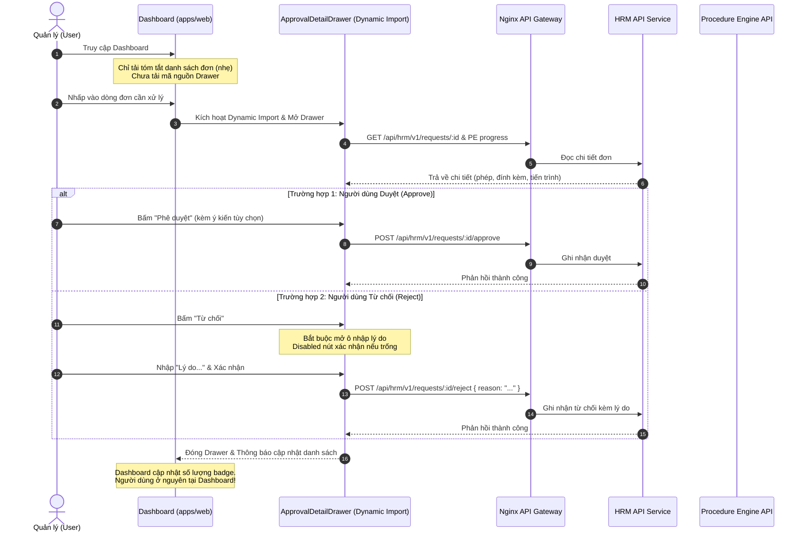

# Đề xuất Kiến trúc & Giải pháp UX: In-Place Approval Drawer trên Dashboard

> **Tài liệu đề xuất giải pháp kỹ thuật**  
> **Dự án**: Enterprise Platform (SaaS ERP)  
> **Chủ đề**: Tối ưu trải nghiệm duyệt đơn tại Dashboard mà vẫn tuân thủ nghiêm ngặt kiến trúc SaaS và tính toàn vẹn nghiệp vụ  
> **Trạng thái**: Đề xuất (Proposed)

---

## 1. Bối cảnh & Đề bài (Context & Problem Statement)

### 1.1. Triết lý kiến trúc cốt lõi của hệ thống
Hệ thống Enterprise Platform được xây dựng dựa trên các nguyên tắc bất biến:
1. **Cô lập dữ liệu tuyệt đối (Database-per-Tenant & Schema-per-Module)**: Mỗi tenant sở hữu một DB riêng; mỗi phân hệ một schema (`core_schema`, `hrm_schema`, `procedure_schema`...). Tuyệt đối không ghi chéo schema; chia sẻ dữ liệu bắt buộc đi qua API hoặc Sự kiện.
2. **Phân ranh giới phân hệ (Decoupled Modular Architecture)**: Các ứng dụng độc lập (`apps/web` cho Core/Portal, `apps/hrm-web`, `apps/hrm-api`, `apps/procedure-engine-api`...). Không tạo phụ thuộc vòng (circular dependencies) hoặc dính chặt mã nguồn giữa các phân hệ.
3. **Bảo mật và toàn vẹn nghiệp vụ ở Server (Server-Enforced Invariants)**: Mọi quy tắc và kiểm tra quyền (`@RequirePermission`, kiểm tra lý do từ chối) phải được thực thi ở backend. Không tạo "lối đi tắt" (backdoors) ở API để phục vụ sự tiện lợi nhất thời trên giao diện.
4. **Giao tiếp bất đồng bộ qua Outbox (Event-Driven Consistency)**: Thay đổi dữ liệu liên phân hệ (ví dụ HRM và Procedure Engine) diễn ra qua transactional outbox và hàng đợi tin nhắn RabbitMQ, chấp nhận tính nhất quán cuối cùng (eventual consistency).

### 1.2. Vấn đề thực tế (The Tension between Architecture & UX)
* **Giai đoạn trước commit `cc575a4`**: Dashboard có widget "Duyệt đơn nhanh" (`quick-work-panel`). Người dùng có thể nhấn nút "Duyệt" hoặc "Từ chối" trực tiếp trên từng dòng. Cách làm này mang lại tiện ích bấm nhanh, nhưng **vi phạm nghiêm trọng kiến trúc**:
  * *Lách luật nghiệp vụ*: Để phục vụ nút bấm "Từ chối" inline không có chỗ nhập chữ, backend HRM phải mở thêm cờ `quick: true` để bỏ qua việc nhập lý do.
  * *Hack đồng bộ*: Đơn liên kết với Procedure Engine cần vài giây để worker đồng bộ về HRM schema. Khi duyệt nhanh ngoài Dashboard, đơn chưa kịp đổi trạng thái, mã nguồn cũ phải tự "ẩn tạm" đơn 20 giây và tạo 4 `setTimeout` để poll lại.
  * *Dính ranh giới frontend*: `apps/web` import trực tiếp các module feature, làm nặng bundle của trang Dashboard.
* **Giai đoạn commit `cc575a4` (PR #133)**: Hệ thống đã chuẩn hóa kiến trúc bằng cách:
  * Xóa hoàn toàn `quick-work-panel` và cờ `quick: true` ở backend.
  * Thay thế bằng thẻ liên kết `ModuleLinkCard` dẫn sang `/modules/hrm/approvals`.
* **Hạn chế phát sinh về mặt UX (Pain Point hiện tại)**:
  * Trang Dashboard (`/dashboard`) thuộc ứng dụng `apps/web`, còn trang Duyệt đơn (`/modules/hrm/approvals`) thuộc ứng dụng `apps/hrm-web`.
  * Nhấp vào link đồng nghĩa với việc trình duyệt phải điều hướng sang app khác (full page navigation). Người quản trị bị **mất hoàn toàn ngữ cảnh công việc hiện tại**.
  * Sau khi thao tác duyệt 1-2 đơn xong, người dùng phải mất công thao tác để tìm đường quay ngược về Bảng điều khiển Core để tiếp tục các công việc khác (như xem báo cáo kho, giao việc workspace, chat...).

---

## 2. Phân tích: Tại sao "Button Duyệt nhanh" vi phạm nhưng "Drawer" lại hợp lệ?

| Tiêu chí | Button Duyệt nhanh (Cách cũ - Vi phạm) | In-Place Drawer (Giải pháp đề xuất - Hợp lệ) |
|---|---|---|
| **Lý do từ chối (Rejection Note)** | Không có diện tích hiển thị form $\rightarrow$ phải lách cờ `quick: true` để backend bỏ qua validation. | Có diện tích đầy đủ để hiển thị ô `Textarea` $\rightarrow$ bắt buộc nhập lý do mới sáng nút Xác nhận. Gọi API chuẩn, không cần cờ lách luật. |
| **Ngữ cảnh thẩm định (Context)** | "Duyệt mù": chỉ thấy tên và loại đơn, không thấy đính kèm, số dư ngày phép, người duyệt trước. | "Duyệt sáng": thấy trọn vẹn số dư phép, hồ sơ chứng từ, quy trình động của Procedure Engine (PE). |
| **Xử lý bất đồng bộ (Async Consistency)** | Dùng hack timer 20 giây và 4 lần polling để ẩn trạng thái chờ đồng bộ giữa PE và HRM. | Drawer hiển thị rõ trạng thái tiến trình từng bước (Step progress), phản hồi tức thì cho người dùng. |
| **Ranh giới đóng gói (Bundle Size)** | Import cứng logic vào Dashboard làm phình bundle của Core Portal. | Nạp lười (**Dynamic Import**): Chỉ tải chunk mã nguồn của Drawer khi người dùng thực sự bấm mở đơn. |
| **Luồng trải nghiệm (UX Flow)** | Bấm nhanh nhưng rủi ro duyệt sai, vi phạm kiểm toán. | Thao tác tại chỗ, mượt mà, **không chuyển trang**, bảo toàn nguyên vẹn ngữ cảnh Dashboard. |

---

## 3. Đặc tả Giải pháp Kỹ thuật: In-Place Approval Drawer

### 3.1. Mô hình kiến trúc luồng dữ liệu (Data & Component Flow)



### 3.2. Thiết kế chi tiết phía Frontend (`apps/web` & `packages/features/hrm`)

#### A. Tách riêng Component Drawer độc lập trong `feature-hrm`
Trong thư mục `packages/features/hrm/src/lib/ui/approvals/`, tạo component xuất khẩu:
* `ApprovalDetailDrawer`: Nhận vào `requestId`, `requestType`, `onSuccess`, `onClose`.
* Chứa toàn bộ logic thẩm định, hiển thị form, gọi API duyệt/từ chối, và kiểm tra quyền.

#### B. Nạp lười tại Dashboard (`apps/web`)
Tại `apps/web/src/app/(tenant)/dashboard/page.tsx`:
* Sử dụng `next/dynamic` với `ssr: false`:
  ```tsx
  import dynamic from 'next/dynamic';

  const ApprovalDetailDrawer = dynamic(
    () => import('@enterprise-platform/feature-hrm').then((m) => m.ApprovalDetailDrawer),
    {
      ssr: false,
      loading: () => <DrawerLoadingSkeleton />,
    }
  );
  ```
* Tenant không dùng HRM hoặc người dùng không có đơn cần duyệt sẽ **không bao giờ phải nạp bundle JavaScript của Drawer này**.

#### C. Thiết kế Giao diện Drawer (UI/UX Ergonomics)
* **Kích thước**: Slide-over Drawer chiếm độ rộng tiêu chuẩn (`max-w-xl` hoặc `max-w-2xl` trên màn hình 16:9), trượt từ phải sang.
* **Khu vực hiển thị**:
  1. *Header*: Tên người làm đơn, loại đơn, thẻ trạng thái (badge), nút đóng `✕`.
  2. *Body*:
     * Khối thông tin cốt lõi (Ngày xin nghỉ / số giờ tăng ca / thời gian công tác).
     * Khối thẩm định nghiệp vụ (Số dư phép năm còn lại, người làm hộ, lý do nộp đơn).
     * Khối đính kèm (Hình ảnh, tệp PDF chứng từ kèm xem trước trực quan).
     * Khối tiến trình phê duyệt (Procedure Engine Stepper: ai đã duyệt, ai kế tiếp).
  3. *Footer*:
     * Nút **"Phê duyệt"** (màu xanh lục emerald-600) kèm icon xác nhận.
     * Nút **"Từ chối"** (màu đỏ rose-600). Khi bấm, trượt mở ô Textarea bắt buộc nhập lý do với validation client-side ngay lập tức.
     * Nút **"Xem toàn màn hình trong HRM"** (nếu người quản lý cần tra cứu sâu hơn lịch sử cả năm của nhân viên).

---

## 4. Kế hoạch Triển khai (Implementation Steps)

1. **Bước 1: Chuẩn hóa Component Drawer trong `@enterprise-platform/feature-hrm`**:
   * Đóng gói lại `ApprovalDetailPanel` (hiện có sẵn trong code HRM) thành `ApprovalDetailDrawer` sử dụng `Sheet` của shadcn/ui.
   * Đảm bảo form từ chối luôn yêu cầu `reason.trim().length > 0`.
   * Export component này từ `packages/features/hrm/src/index.ts`.
2. **Bước 2: Tích hợp Lazy Load vào Dashboard của `apps/web`**:
   * Tại thẻ "Đơn từ cần xử lý" trên Dashboard, hiển thị danh sách tóm tắt (3-5 đơn gần nhất).
   * Khi nhấp vào đơn, đặt state `selectedRequestKey` để mở Drawer.
   * Đảm bảo dynamic import chạy mượt mà, có skeleton loading rõ ràng.
3. **Bước 3: Kiểm thử toàn diện**:
   * Kiểm thử tự động (Unit / Integration spec):
     * Từ chối không có lý do phải bị chặn ở cả Frontend lẫn Backend (`400 Bad Request`).
     * Duyệt đơn cập nhật đúng trạng thái và làm mới danh sách ngoài Dashboard.
   * Kiểm tra kích thước gói mã (Bundle analysis): Dashboard không bị tăng kích thước initial bundle.
   * Chạy kiểm tra quy chuẩn:
     ```bash
     pnpm nx affected -t lint typecheck test
     node tools/check-ui-rules.mjs
     ```

---

## 5. Kết luận

Phương án **In-Place Approval Drawer** giải quyết triệt để sự mâu thuẫn giữa **Kỷ luật Kiến trúc** và **Trải nghiệm Người dùng**:
* **Không thỏa hiệp về kiến trúc**: Backend giữ nguyên luật kiểm soát lý do từ chối nghiêm ngặt; dữ liệu đi đúng API phân hệ; frontend không bị dính bundle nhờ cơ chế nạp lười.
* **Tối ưu tối đa cho người dùng**: Nhà quản lý duyệt đơn nhanh chóng ngay tại Dashboard, nắm trọn vẹn ngữ cảnh hồ sơ, và không bao giờ bị đứt gãy luồng làm việc do phải chuyển trang.
