# Tài liệu thiết kế app mobile: Phân ca, Nhả ca, Ngoại lệ (HRM)

Nguồn: giao diện web `/modules/hrm/settings?view=schedules`. Tài liệu này chỉ mô tả thao tác trên web, dữ liệu và API tương ứng để đội mobile dựng lại. Không thiết kế giao diện mobile.

**Phạm vi.** Ba chức năng trong tab Phân ca của Cài đặt HRM:

| Chức năng | Vị trí trên web |
|---|---|
| Phân ca | `?view=schedules&tab=assign` |
| Nhả ca | `?view=schedules&tab=release` |
| Tạo ngoại lệ | `?view=schedules&tab=calendar`, menu **Công cụ phân ca → Thiết lập ngoại lệ**, hoặc bấm một ô trên lưới lịch |

Không thuộc phạm vi: Mẫu lịch tuần, Sao chép lịch, Lịch định kỳ, Lịch lễ/Tết, chấm công. Các mục đó chỉ được nhắc khi nó là dữ liệu đầu vào của ba chức năng trên.

**Ảnh minh hoạ.** Ảnh nằm ở `images/`, khung đỏ có số thứ tự là dữ liệu hoặc nút cần thao tác. Sinh bằng `capture-screenshots.mjs`.

---

## 1. Quy ước API chung

- Gốc: `/api/hrm/v1`. Các route bên dưới viết tắt theo gốc này.
- Web dùng cookie phiên và header `x-csrf-token` (giá trị lấy từ cookie `ep_csrf`). Cơ chế xác thực của app mobile cần thống nhất riêng, tài liệu này không quy định.
- Thành công: `{ "data": ..., "meta": { "requestId": "..." } }`.
- Lỗi: HTTP 4xx kèm `{ "message": "<tiếng Việt>", "code": "<mã>", ... }`. Mã lỗi nghiệp vụ ở mục 6.
- Ngày là chuỗi ISO `YYYY-MM-DD`. Thứ trong tuần theo ISO: `1` = Thứ hai … `7` = Chủ nhật.
- Chữ trên giao diện và `message` lỗi: tiếng Việt có dấu.

## 2. API tra cứu (dữ liệu để dựng form)

| Dữ liệu | API | Dùng cho |
|---|---|---|
| Nhân viên đang làm việc | `GET /employee-options?page=1&page_size=100` (lặp tăng `page` đến hết `meta.total`) → `{ data: [{ employeeId, employeeCode, fullName, department }] }` | Chọn nhân viên (hiển thị `NV001 · Họ tên`) |
| Đơn vị | `GET /shift-units` → `{ data: [{ id, parent_id, code, name }] }` | Đối tượng "Theo đơn vị" |
| Danh mục ca | `GET /shifts` → `HrmShiftDefinition[]` (`id, code, name, startTime, endTime, status…`) | Chọn ca |
| Mẫu lịch tuần | `GET /work-schedule-templates` → `{ data: [{ id, code, name, status, days: HrmWeekdayRule[] }] }`; chỉ dùng mẫu `status = ACTIVE` | "Dùng mẫu lịch đã lưu" |
| Lưới lịch | `GET /work-schedules/grid?from&to&unitId&includeChildUnits&q&coverage=unassigned&page&pageSize=50` | Tab Lịch làm việc, chọn ô để tạo ngoại lệ |
| Danh sách | `GET /work-schedules/list?...` (cùng tham số) | Dạng danh sách |
| Lịch sử thao tác | `GET /work-schedules/audit?employeeId&batchId&limit` | Lịch sử phân ca gần đây |

Quyền cho mọi API tra cứu: `hrm.schedule.read` (`/employee-options` và `/shifts` theo quyền của chính chúng).

### Kiểu dữ liệu dùng chung

```jsonc
// HrmWeekdayRule: một thứ trong tuần
{ "weekday": 1, "dayType": "SHIFT" | "OFF" | "SKIP", "shiftId": "<uuid>" | null }

// HrmScheduleScope: đối tượng áp dụng
{ "type": "EMPLOYEE",  "employeeIds": ["<uuid>"] }                       // đúng 1 phần tử
{ "type": "EMPLOYEES", "employeeIds": ["<uuid>", "<uuid>"] }
{ "type": "UNIT",      "unitIds": ["<uuid>"], "includeChildUnits": true, "excludeEmployeeIds": [] }
{ "type": "COMPANY",   "excludeEmployeeIds": [] }
```

`SKIP` = không đụng tới thứ đó. `shiftId` chỉ có giá trị khi `dayType = SHIFT`, các trường hợp khác gửi `null`.

Quy tắc dựng `scope` (web `buildScope`): với lịch **không có ngày kết thúc**, `UNIT` chỉ gửi `{ type, unitIds }` và `COMPANY` chỉ gửi `{ type }`, không gửi `includeChildUnits` hay `excludeEmployeeIds` (server không hỗ trợ). Ô "Loại trừ nhân viên" và "Bao gồm các đơn vị con" ẩn đi trong trường hợp đó.

Mặc định mỗi form: `OVERWRITE_KEEP_EXCEPTIONS` là chế độ xử lý xung đột của ngoại lệ; `REPORT` của Phân ca.

---

## 3. Phân ca

Gán ca làm việc theo lịch tuần cho một hoặc nhiều nhân viên, từ một ngày, có hoặc không có ngày kết thúc.

### 3.1 Thao tác trên web

Mở `?view=schedules&tab=assign`.

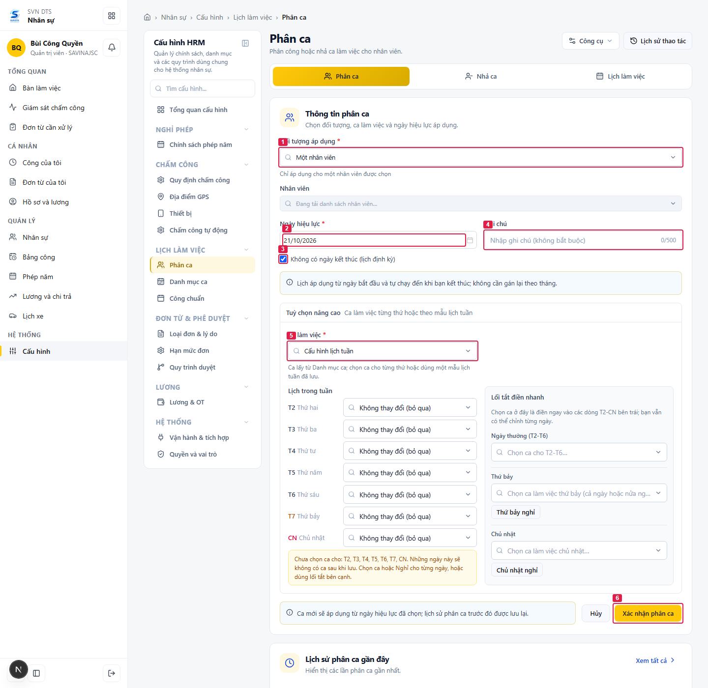

| # | Phần tử | Ghi chú |
|---|---|---|
| 1 | **Đối tượng áp dụng** (ô chọn) | Một nhân viên / Nhiều nhân viên / Theo đơn vị / Toàn bộ nhân viên. Đổi lựa chọn thì phần bên dưới đổi theo: chọn nhân viên; danh sách nhiều nhân viên có ô tìm và chọn hàng loạt; chọn đơn vị kèm "Bao gồm các đơn vị con"; toàn công ty hiện số nhân viên bị ảnh hưởng. |
| 2 | **Ngày hiệu lực** (bắt buộc) | Mặc định hôm nay. |
| 3 | Checkbox **Không có ngày kết thúc (lịch định kỳ)** | Mặc định bật. Bỏ tick thì hiện ô **Đến ngày** (tối đa 366 ngày mỗi lần). |
| 4 | **Ghi chú** | Tuỳ chọn, tối đa 500 ký tự. |
| 5 | **Tuỳ chọn nâng cao → Ca làm việc** | Hiển thị đầy đủ ngay từ đầu. Chọn "Cấu hình lịch tuần" (7 dòng T2–CN, mỗi dòng chọn ca / Nghỉ / Bỏ qua, có lối tắt T2–T6, T7, CN) hoặc "Dùng mẫu lịch đã lưu". |
| 6 | Nút **Xác nhận phân ca** | Kiểm tra dữ liệu, gọi xem trước, mở popup tổng quan. |

Chọn đối tượng và ca:

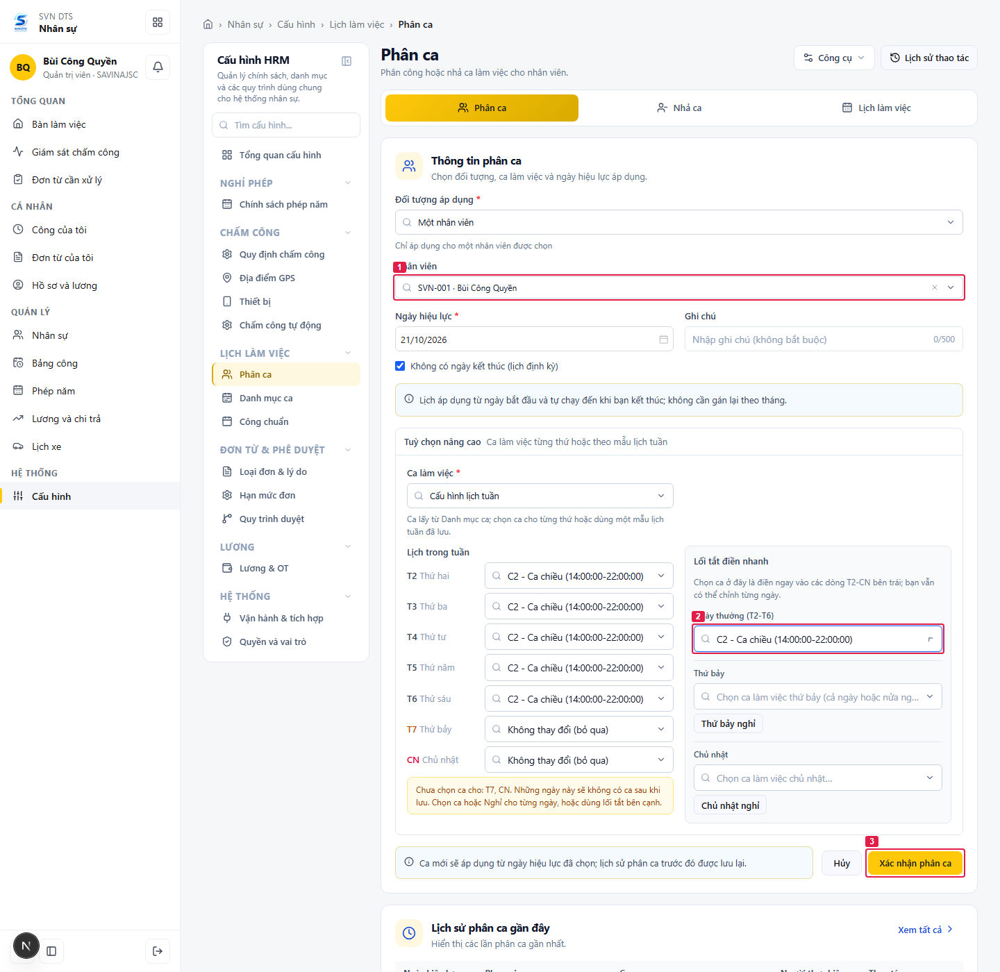

Bấm **Xác nhận phân ca** → popup **Tổng quan phân ca**:

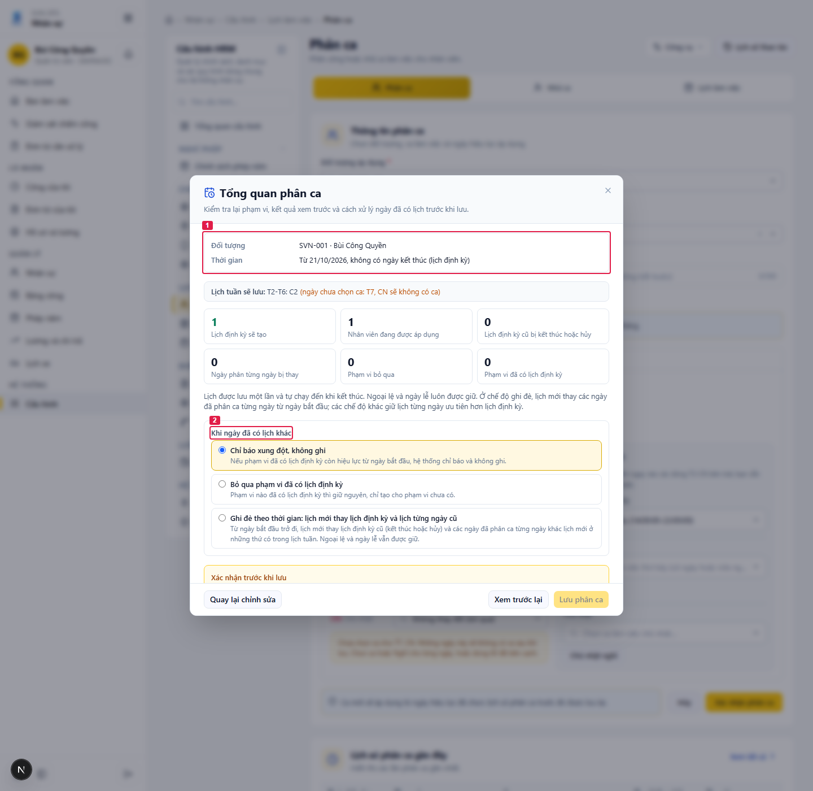

Cuộn xuống cuối popup:

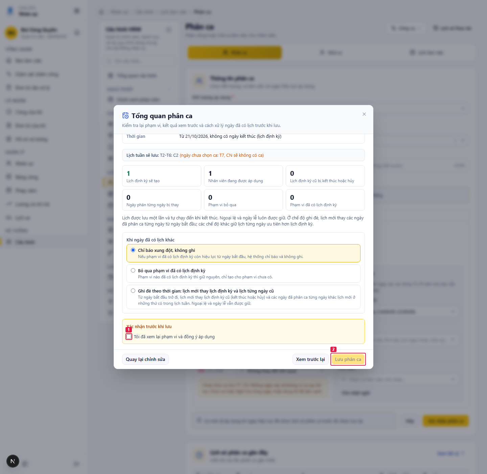

| # | Phần tử | Ghi chú |
|---|---|---|
| 1 | Khối tổng quan | Đối tượng, thời gian, ghi chú; bên dưới là lịch tuần sẽ lưu và kết quả xem trước (với lịch định kỳ: số lịch sẽ tạo, nhân viên áp dụng, lịch cũ bị kết thúc hoặc hủy; với khoảng ngày: số ngày thêm/ghi đè/bỏ qua, xung đột, kỳ công khoá). |
| 2 | Thẻ **Khi ngày đã có lịch khác** | 4 chế độ (mục 3.4). Đổi chế độ thì tự xem trước lại. |
| 3 (ảnh 03b) | Checkbox **Tôi đã xem lại phạm vi và đồng ý áp dụng** | Chỉ cần tick, không phải gõ chữ. Tick lại từ đầu sau mỗi lần xem trước lại. |
| 4 (ảnh 03b) | Nút **Lưu phân ca** | Bật khi: xem trước xong, không còn xung đột chặn, không có kỳ công khoá, có ít nhất 1 ngày để ghi, và đã tick xác nhận. |

Luồng: nhập form → **Xác nhận phân ca** → (gọi `preview`) → xem tổng quan, chọn cách xử lý xung đột nếu cần → tick xác nhận → **Lưu phân ca** (gọi `apply`) → hiển thị kết quả, form trở về mặc định.

### 3.2 Kiểm tra dữ liệu trước khi gọi API

| Điều kiện | Thông báo |
|---|---|
| `EMPLOYEE` không đúng 1 nhân viên | "Chọn một nhân viên." |
| `EMPLOYEES` chưa chọn ai | "Chọn ít nhất một nhân viên." |
| `UNIT` chưa chọn đơn vị | "Chọn ít nhất một đơn vị." |
| Lịch tuần toàn `SKIP` | "Cần cấu hình ít nhất một ngày trong tuần (ca hoặc nghỉ)." |
| Có dòng `SHIFT` chưa chọn ca | "Chọn ca cho <thứ>." |
| Dùng mẫu nhưng chưa chọn | "Chọn một mẫu lịch tuần." |
| Có ngày kết thúc: ngày sai/thiếu | "Nhập đầy đủ từ ngày và đến ngày." |
| `fromDate` > `toDate` | "Từ ngày phải trước hoặc bằng đến ngày." |
| Quá 366 ngày | "Khoảng ngày tối đa 366 ngày." |
| Không có ngày kết thúc, `UNIT`/`COMPANY` có loại trừ nhân viên | "Lịch không có ngày kết thúc không hỗ trợ loại trừ nhân viên…" |

### 3.3 API và payload

| Bước | API | Quyền |
|---|---|---|
| Xem trước | `POST /work-schedules/preview` | `manage` (+ `bulk` nếu không phải một nhân viên, + `calendar` nếu ghi đè tất cả) |
| Lưu | `POST /work-schedules` | như trên |

Cả hai nhận cùng một thân `HrmApplyScheduleRequest`. Web gửi `preview` trước, và thân `apply` phải **giống hệt** thân `preview` (trừ `confirm`); đổi bất kỳ trường nào sau khi xem trước thì phải xem trước lại.

**Lịch có ngày kết thúc (khoảng ngày) — dùng mẫu:**

```json
POST /api/hrm/v1/work-schedules/preview
{
  "kind": "ASSIGN",
  "scope": { "type": "EMPLOYEE", "employeeIds": ["<employeeId>"] },
  "fromDate": "2026-10-21",
  "toDate": "2026-11-20",
  "templateId": "<templateId>",
  "conflictMode": "REPORT",
  "reason": null
}
```

**Lịch có ngày kết thúc — tự cấu hình lịch tuần** (thay `templateId` bằng `pattern`, đủ 7 phần tử):

```json
{
  "kind": "ASSIGN",
  "scope": { "type": "UNIT", "unitIds": ["<unitId>"], "includeChildUnits": true, "excludeEmployeeIds": [] },
  "fromDate": "2026-10-21",
  "toDate": "2026-11-20",
  "pattern": [
    { "weekday": 1, "dayType": "SHIFT", "shiftId": "<shiftId>" },
    { "weekday": 2, "dayType": "SHIFT", "shiftId": "<shiftId>" },
    { "weekday": 3, "dayType": "SHIFT", "shiftId": "<shiftId>" },
    { "weekday": 4, "dayType": "SHIFT", "shiftId": "<shiftId>" },
    { "weekday": 5, "dayType": "SHIFT", "shiftId": "<shiftId>" },
    { "weekday": 6, "dayType": "SHIFT", "shiftId": "<halfDayShiftId>" },
    { "weekday": 7, "dayType": "OFF",   "shiftId": null }
  ],
  "conflictMode": "OVERWRITE_KEEP_EXCEPTIONS",
  "reason": "Chuyển ca theo kế hoạch"
}
```

**Không có ngày kết thúc (lịch định kỳ):** **bỏ hẳn `toDate`** (không gửi `null`); `scope` rút gọn như mục 2.

```json
{
  "kind": "ASSIGN",
  "scope": { "type": "COMPANY" },
  "fromDate": "2026-11-01",
  "templateId": "<templateId>",
  "conflictMode": "REPORT"
}
```

**Lưu (`apply`):** gửi lại đúng thân đó. Thêm `"confirm": true` khi cần xác nhận (mục 3.5).

**Phản hồi xem trước — khoảng ngày (`HrmSchedulePreview`):**

```jsonc
{ "data": {
  "summary": { "insert": 20, "replace": 2, "same": 0, "skipped": 0, "conflicts": 0, "employees": 1 },
  "employeeCount": 1, "dayCount": 22,
  "conflictTotal": 0,
  "conflicts": [ { "employeeId": "", "employeeCode": "NV001", "employeeName": "", "date": "2026-10-23",
                   "existing": { "dayType": "SHIFT", "shiftCode": "HC", "source": "MANUAL" },
                   "incoming": { "dayType": "SHIFT", "shiftCode": "HC4" } } ],
  "employees": [ { "employeeId": "", "code": "NV001", "name": "", "unitName": "", "days": 22 } ],
  "requiresConfirmation": false, "confirmReasons": [],
  "lockedPeriods": [],
  "requestConflictTotal": 0, "blockingRequestConflictTotal": 0, "requestConflicts": []
} }
```

**Phản hồi xem trước — không có ngày kết thúc (`HrmScheduleRulePreview`):** `rules[]` (mỗi phạm vi kèm `changes[]` gồm `action: TRUNCATE|CANCEL`, `from`, `to`, `newTo`), `ruleCount`, `changedRules`, `employeeCount`, `conflictTotal`, `skippedTargets`, `replacedDays`, `replacedEmployees`, `requiresConfirmation`, `confirmReasons`, `lockedPeriods`.

**Phản hồi lưu:**

```jsonc
// Khoảng ngày
{ "data": { "batchId": "", "summary": { "insert": 20, "replace": 2, ... }, "employeeCount": 1, "appliedDays": 22 } }
// Không có ngày kết thúc
{ "data": { "batchId": "", "ruleCount": 1, "changedRules": 0, "skippedTargets": 0, "employeeCount": 1, "replacedDays": 0 } }
```

Web phân biệt hai dạng phản hồi bằng sự có mặt của `rules` (xem trước) hoặc `ruleCount` (lưu).

### 3.4 Chế độ "Khi ngày đã có lịch khác" (`conflictMode`)

| Giá trị | Ý nghĩa | Quyền |
|---|---|---|
| `REPORT` | Có ngày trùng thì báo xung đột, không ghi gì (mặc định của Phân ca) | |
| `SKIP_EXISTING` | Chỉ gán ngày chưa có lịch | |
| `OVERWRITE_KEEP_EXCEPTIONS` | Thay lịch thường bằng lịch mới, giữ ngoại lệ và ngày lễ | |
| `OVERWRITE_ALL` | Ghi đè tất cả, kể cả ngoại lệ | cần `calendar`; **không dùng** khi không có ngày kết thúc |

Khi không có ngày kết thúc, nhãn đổi nghĩa: "Bỏ qua phạm vi đã có lịch định kỳ", "Ghi đè theo thời gian: lịch mới thay lịch định kỳ và lịch từng ngày cũ". Nếu người dùng bật "không có ngày kết thúc" khi đang ở `OVERWRITE_ALL` thì web tự đổi sang `OVERWRITE_KEEP_EXCEPTIONS`.

### 3.5 Xác nhận và điều kiện bật nút Lưu

`confirm: true` chỉ gửi khi **cần xác nhận**, tức là một trong ba: `requiresConfirmation` của xem trước là `true`; server từng trả `HRM_SCHEDULE_CONFIRM_REQUIRED`; hoặc đối tượng là `COMPANY` (web luôn thêm lý do "Áp dụng cho toàn công ty"). Danh sách lý do lấy từ `confirmReasons`.

Nút Lưu bật khi tất cả đúng:

1. Có kết quả xem trước khớp thân yêu cầu hiện tại.
2. Không có xung đột chặn theo chế độ đang chọn (`conflicts` > 0 với `REPORT`; `blockingRequestConflictTotal` > 0; xung đột lịch định kỳ).
3. `lockedPeriods` rỗng.
4. Có ít nhất 1 ngày để ghi (khoảng ngày: `insert + replace` > 0).
5. Đã tick xác nhận.

---

## 4. Nhả ca

Hủy (gỡ) lịch đã phân của nhân viên trong một khoảng ngày.

### 4.1 Thao tác trên web

Mở `?view=schedules&tab=release`.

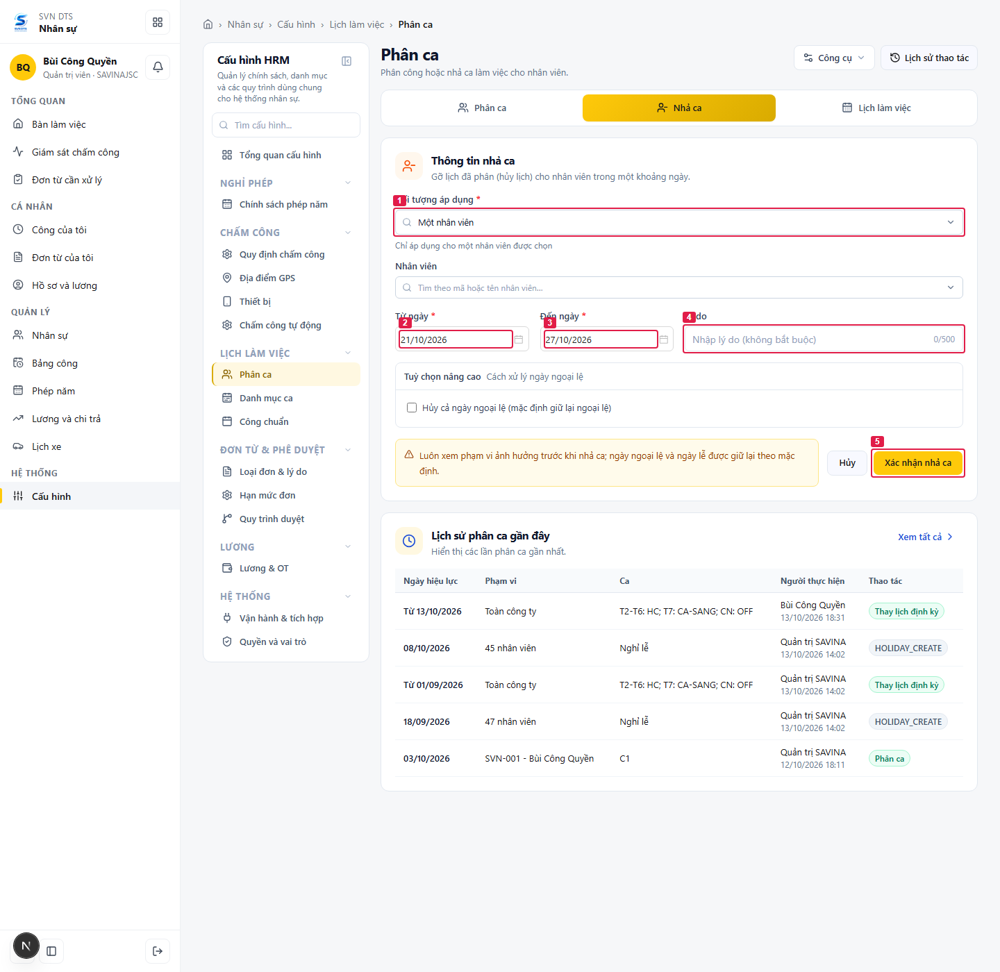

| # | Phần tử | Ghi chú |
|---|---|---|
| 1 | **Đối tượng áp dụng** | Giống Phân ca (ô chọn). Không có "loại trừ nhân viên" và "đơn vị con" riêng, `scope` dựng theo dạng không có ngày kết thúc. |
| 2 | **Từ ngày** (bắt buộc) | Mặc định hôm nay. |
| 3 | **Đến ngày** (bắt buộc) | Mặc định hôm nay + 6 ngày. Tối đa 366 ngày. |
| 4 | **Lý do** | Tuỳ chọn, tối đa 500 ký tự. |
| 5 | Nút **Xác nhận nhả ca** | Kiểm tra rồi mở popup. |

Có `hrm.schedule.calendar`, bên dưới có khối **Tuỳ chọn nâng cao** chứa checkbox "Hủy cả ngày ngoại lệ (mặc định giữ lại ngoại lệ)".

Popup **Tổng quan nhả ca**:

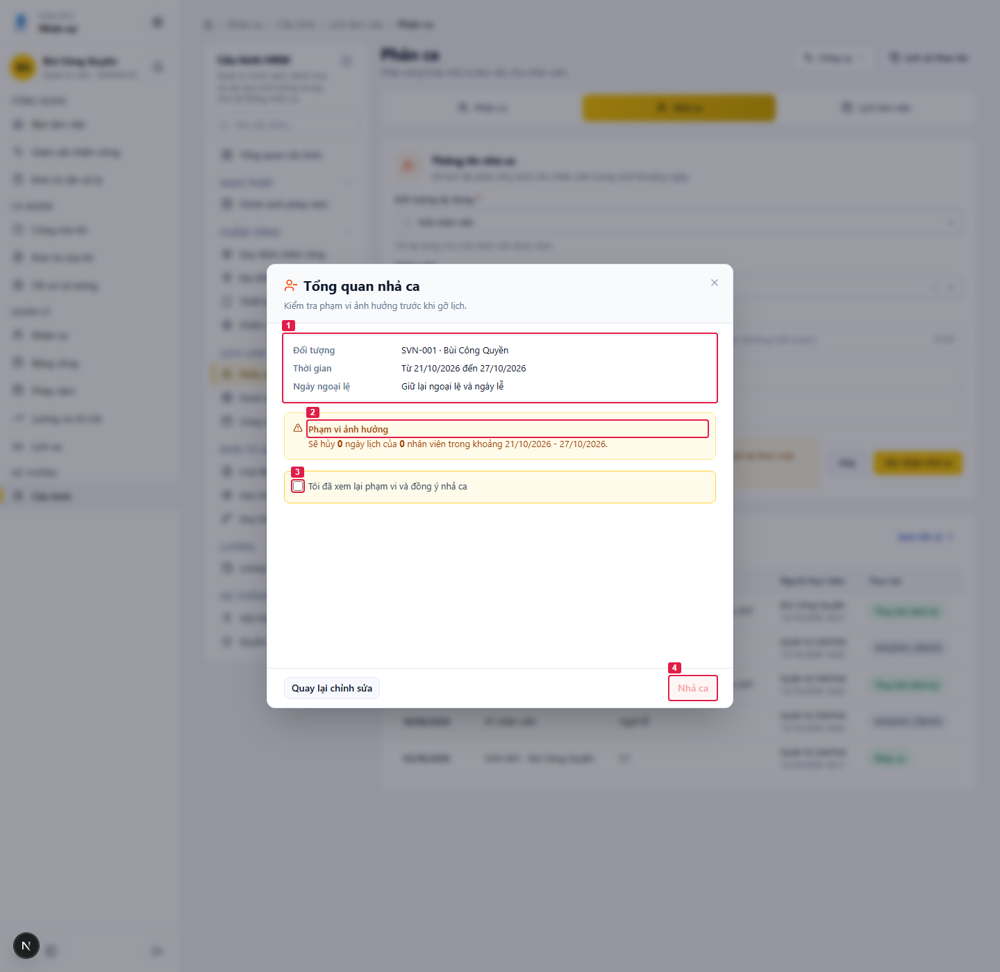

| # | Phần tử | Ghi chú |
|---|---|---|
| 1 | Khối tổng quan | Đối tượng, thời gian, cách xử lý ngoại lệ, lý do |
| 2 | **Phạm vi ảnh hưởng** | "Sẽ hủy N ngày lịch của M nhân viên trong khoảng …"; kèm "K ngày ngoại lệ hoặc ngày lễ được giữ lại" nếu có |
| 3 | Checkbox **Tôi đã xem lại phạm vi và đồng ý nhả ca** | Chỉ cần tick |
| 4 | Nút **Nhả ca** | Bật khi xem trước xong, `dayCount > 0` và đã tick |

Luồng: nhập form → **Xác nhận nhả ca** → tự gọi xem trước (`dryRun: true`) → xem phạm vi → tick → **Nhả ca** (`confirm: true, dryRun: false`).

### 4.2 API và payload

Một API cho cả hai bước: `POST /work-schedules/cancel`. Quyền `manage`, thêm `bulk` nếu đối tượng không phải một nhân viên, thêm `calendar` nếu `includeExceptions: true`.

**Xem phạm vi (dry-run):**

```json
POST /api/hrm/v1/work-schedules/cancel
{
  "scope": { "type": "EMPLOYEE", "employeeIds": ["<employeeId>"] },
  "fromDate": "2026-10-21",
  "toDate": "2026-10-27",
  "includeExceptions": false,
  "reason": null,
  "dryRun": true
}
```

Phản hồi: `{ "data": { "employeeCount": 1, "dayCount": 7, "keptProtected": 1, "batchId": null } }`

**Nhả ca thật:** gửi cùng thân nhưng `"confirm": true, "dryRun": false`.

Phản hồi: `{ "data": { "employeeCount": 1, "dayCount": 7, "keptProtected": 1, "batchId": "<uuid>" } }`. Web báo "Đã hủy {dayCount} ngày lịch của {employeeCount} nhân viên." và làm mới lưới.

Ghi chú: `includeExceptions` chỉ được gửi `true` khi người dùng có quyền `calendar` và đã tick; nếu không web luôn gửi `false`. `reason` là `null` khi để trống.

---

## 5. Tạo ngoại lệ

Đặt **một ca hoặc ngày nghỉ riêng** cho một khoảng ngày; ưu tiên hơn lịch tuần và lịch định kỳ. Cần quyền `hrm.schedule.calendar`.

### 5.1 Lối vào

1. Menu **Công cụ phân ca → Thiết lập ngoại lệ** (tab Lịch làm việc).
2. **Bấm một ô trên lưới lịch**: tự điền sẵn nhân viên của hàng đó và ngày của ô (từ ngày = đến ngày).
3. Nút ngoại lệ trong **panel chi tiết nhân viên**: tự điền sẵn nhân viên.

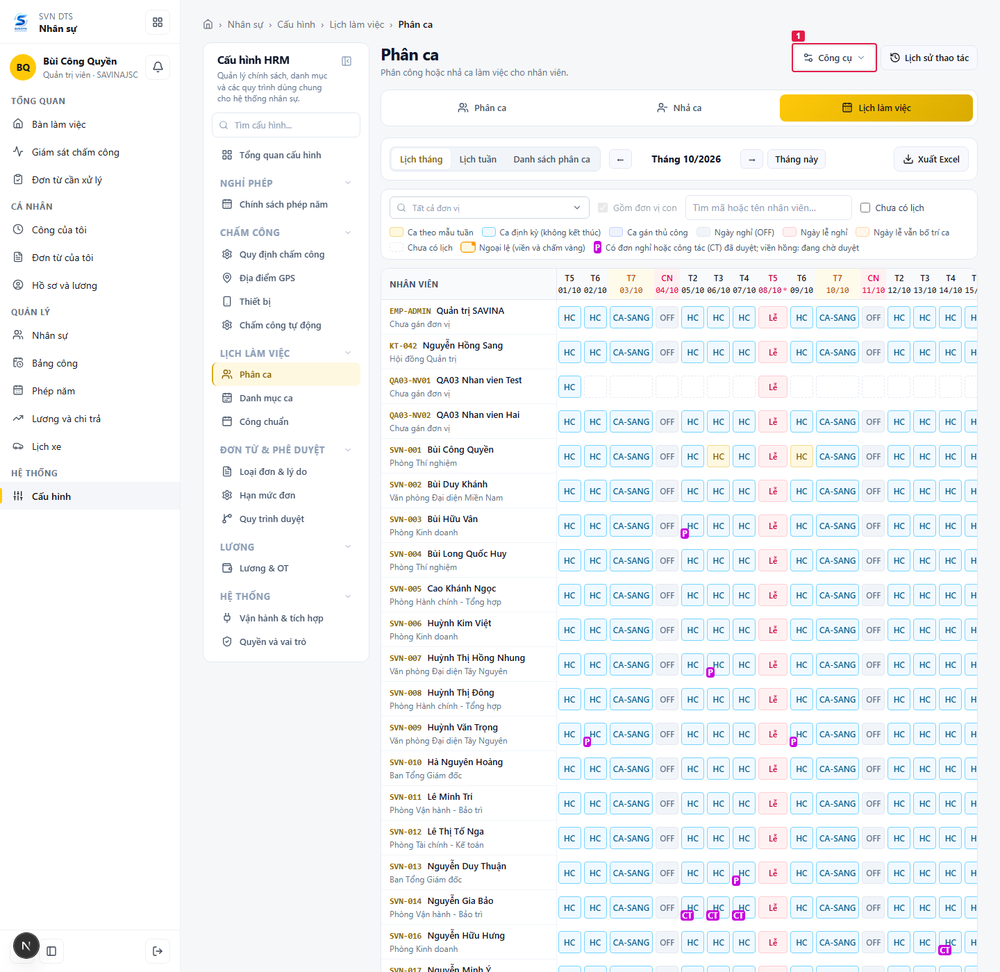

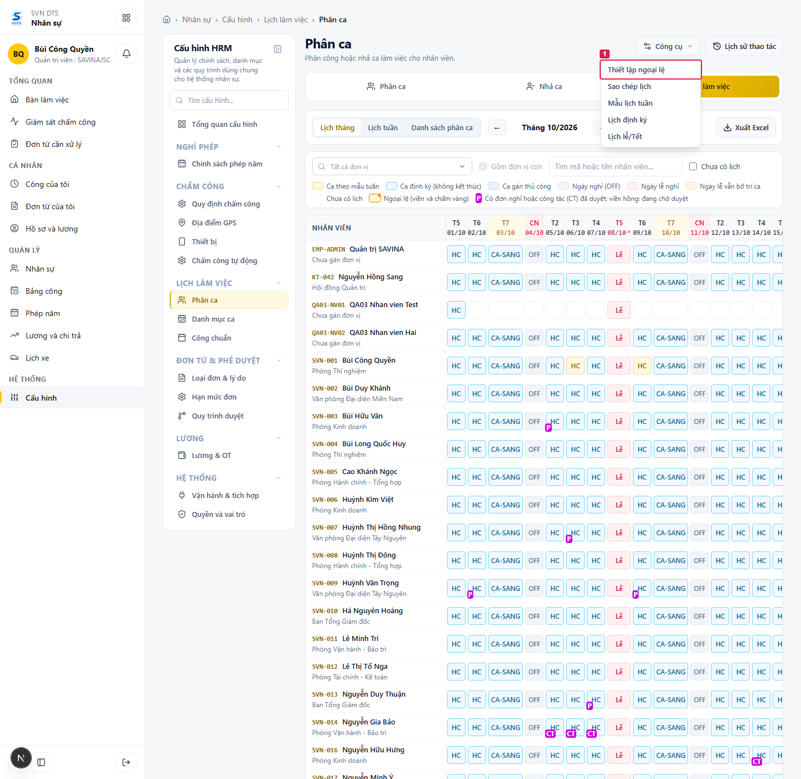

### 5.2 Bốn bước trong hộp thoại

**Bước 1 — Phạm vi** ("Áp dụng cho ai"): chọn đối tượng như Phân ca (nhiều nhân viên, đơn vị, toàn công ty cần `bulk`).

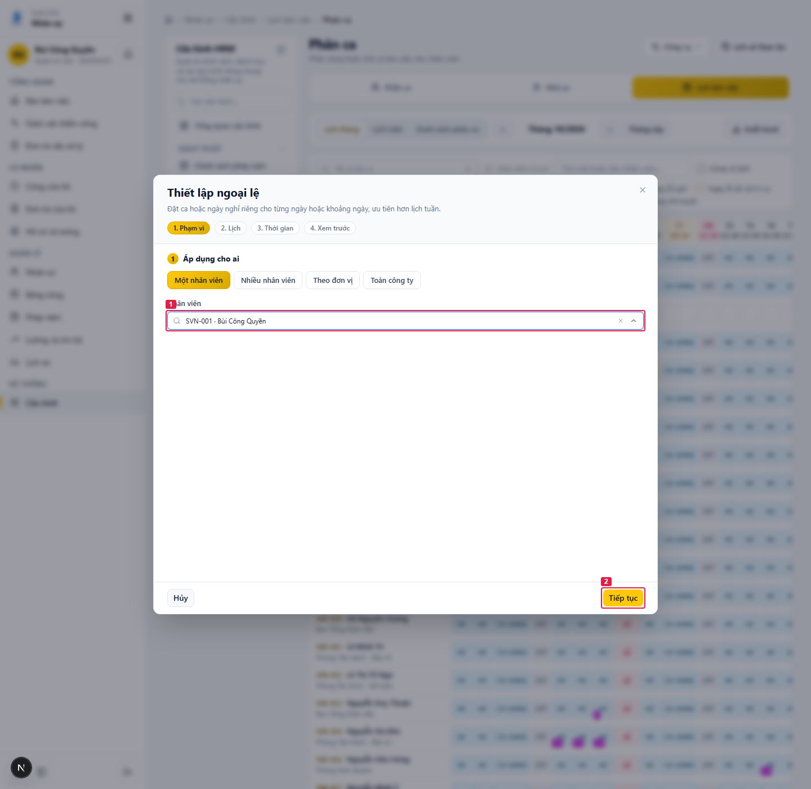

**Bước 2 — Ca ngoại lệ**: chọn một trong hai.

- **Nghỉ**: các ngày trong khoảng thành ngày OFF.
- **Làm theo ca**: chọn một ca từ Danh mục ca. Chưa chọn thì báo "Chọn ca cho ngoại lệ."

Áp dụng như nhau cho mọi ngày T2–CN trong khoảng, không có lịch từng thứ.

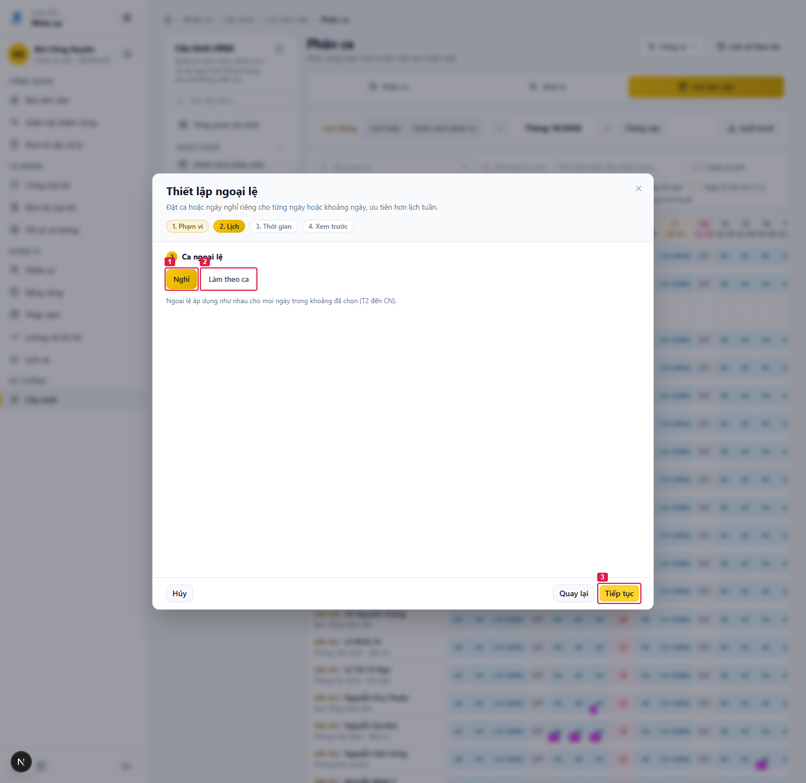

**Bước 3 — Thời gian và xử lý xung đột**: Từ ngày, Đến ngày (luôn bắt buộc, không có "không kết thúc", tối đa 366 ngày), Lý do (tuỳ chọn, 500 ký tự), thẻ **Khi ngày đã có lịch khác**.

- Mặc định: mở từ ô lịch thì một ngày; mở từ menu thì từ hôm nay đến +29 ngày.
- Chế độ mặc định: `OVERWRITE_KEEP_EXCEPTIONS` (ghi đè lịch thường, giữ ngoại lệ khác và ngày lễ).

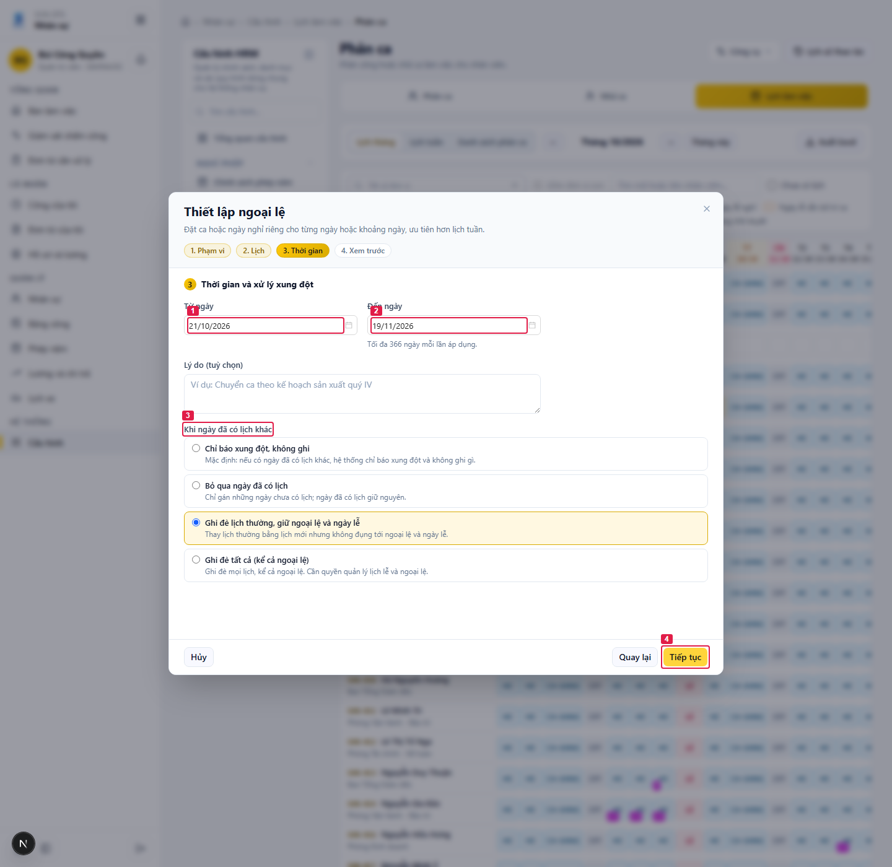

**Bước 4 — Xem trước**: server tính trước ngày sẽ ghi, xung đột, kỳ công khoá; tick xác nhận khi cần rồi **Lưu phân ca**.

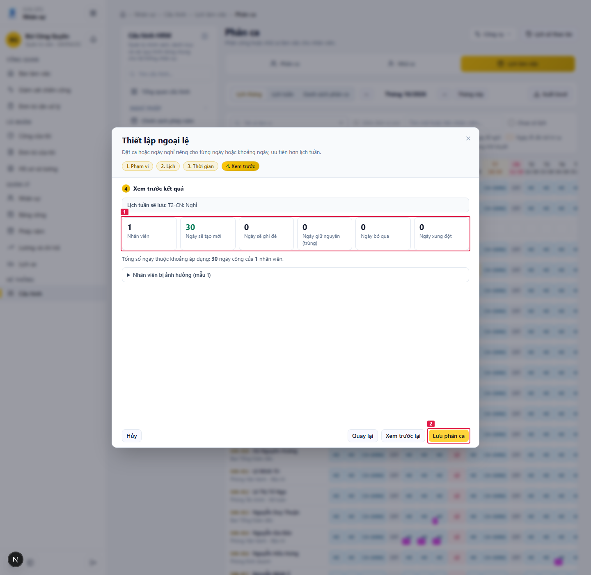

Hộp thoại ngoại lệ vẫn là luồng 4 bước (chưa đổi sang popup tổng quan như Phân ca và Nhả ca). Nút Lưu bật theo các điều kiện ở mục 3.5.

### 5.3 API và payload

Dùng cùng API Phân ca (`preview` rồi `apply`) với `kind: "EXCEPTION"`. **Bắt buộc có `toDate`**. Thay vì lịch tuần thật, web tạo sẵn `pattern` đủ 7 ngày giống hệt nhau.

**Ngoại lệ "Nghỉ" cho một ngày:**

```json
POST /api/hrm/v1/work-schedules/preview
{
  "kind": "EXCEPTION",
  "scope": { "type": "EMPLOYEE", "employeeIds": ["<employeeId>"] },
  "fromDate": "2026-10-23",
  "toDate": "2026-10-23",
  "pattern": [
    { "weekday": 1, "dayType": "OFF", "shiftId": null },
    { "weekday": 2, "dayType": "OFF", "shiftId": null },
    { "weekday": 3, "dayType": "OFF", "shiftId": null },
    { "weekday": 4, "dayType": "OFF", "shiftId": null },
    { "weekday": 5, "dayType": "OFF", "shiftId": null },
    { "weekday": 6, "dayType": "OFF", "shiftId": null },
    { "weekday": 7, "dayType": "OFF", "shiftId": null }
  ],
  "conflictMode": "OVERWRITE_KEEP_EXCEPTIONS",
  "reason": "Nghỉ theo yêu cầu"
}
```

**Ngoại lệ "Làm theo ca":** giống trên nhưng mỗi phần tử là `{ "weekday": n, "dayType": "SHIFT", "shiftId": "<shiftId>" }` với `n` từ 1 đến 7.

Lưu: `POST /work-schedules` với cùng thân; thêm `"confirm": true` khi cần (mục 3.5). Phản hồi xem trước và lưu là dạng khoảng ngày (`HrmSchedulePreview`, `HrmApplyScheduleResult`).

Quyền: `calendar` + (`manage` nếu một nhân viên, hoặc `bulk` nếu nhiều nhân viên, đơn vị, toàn công ty).

---

## 6. Mã lỗi nghiệp vụ

Tất cả là HTTP 409 trừ khi ghi khác. Client phân loại theo `code`.

| `code` | Ý nghĩa | Dữ liệu kèm theo | Cách web xử lý |
|---|---|---|---|
| `HRM_SCHEDULE_CONFLICT` | Có ngày đã có lịch khác (chế độ `REPORT`) | `conflicts[]`, `summary.conflicts` | Hiện bảng xung đột, chặn lưu; gợi ý đổi `conflictMode` rồi xem trước lại |
| `HRM_SCHEDULE_RULE_CONFLICT` | Phạm vi đã có lịch định kỳ còn hiệu lực (khi không có ngày kết thúc) | `rules[]`, `conflictTotal` | Hiện danh sách lịch bị ảnh hưởng, chặn lưu |
| `HRM_SCHEDULE_REQUEST_CONFLICT` | Đổi ca/OFF trùng đơn nghỉ hoặc công tác **đã duyệt** | `requestConflicts[]`, `requestConflictTotal` | Chặn; đơn đang chờ chỉ cảnh báo |
| `HRM_SCHEDULE_CONFIRM_REQUIRED` | Cần `confirm: true` | `confirmReasons[]` | Hiện lý do, yêu cầu tick rồi gửi lại với `confirm: true` |
| `HRM_SCHEDULE_NOT_MIGRATED` | Chưa khởi tạo dữ liệu phân ca cho tenant | | Thay cả màn hình bằng thông báo liên hệ quản trị |
| `HRM_SCHEDULE_RULES_NOT_MIGRATED` | Thiếu bảng lịch định kỳ | | Báo lỗi cục bộ; gợi ý phân theo khoảng ngày |
| (không có `code`, thông điệp chứa "kỳ công đã khoá") | Kỳ công đã khoá | | "Kỳ công trong khoảng ngày này đã khoá. Cần mở lại kỳ công trước khi thay đổi lịch." |
| `403` | Không còn quyền | | Làm mới quyền, báo "Bạn không còn quyền thực hiện thao tác này." |
| `401` | Hết phiên | | Quay về đăng nhập |
