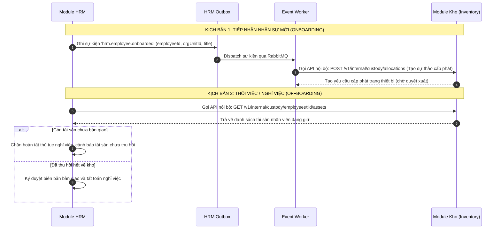
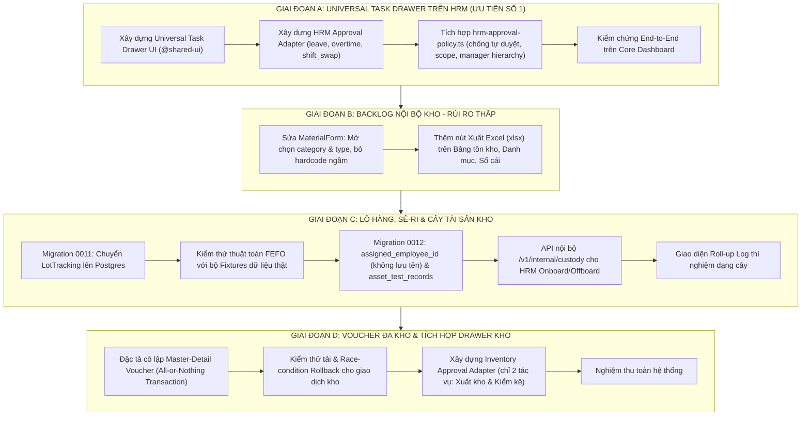

# Kế hoạch Kỹ thuật: Phân định Backlog Nhà kho & Tích hợp Universal Task Drawer

> **Mã kế hoạch:** PLAN-INVENTORY-REFINED-03  
> **Thuộc kế hoạch tổng thể:** [README.md](file:///d:/CRM/enterprise-platform/docs/plan_core_drawler/README.md)  
> **Kế thừa đặc tả:**  
> - [01_APPROVAL_CONTRACT_SPEC.md](file:///d:/CRM/enterprise-platform/docs/plan_core_drawler/01_APPROVAL_CONTRACT_SPEC.md) (Approval Contract DTOs)  
> - [02_UNIVERSAL_TASK_DRAWER_SPEC.md](file:///d:/CRM/enterprise-platform/docs/plan_core_drawler/02_UNIVERSAL_TASK_DRAWER_SPEC.md) (Universal Task Drawer Component)  
> **Trạng thái:** Kế hoạch kiến trúc đã tinh chỉnh theo phản biện kỹ thuật (Refined Architectural Plan)

---

## 1. Phân Tích & Tái Cấu Trúc Kiến Trúc (Architectural Refinement)

Dựa trên phản biện chuyên sâu về mặt ranh giới phân hệ và quản trị rủi ro hệ thống:

```
                                  PHÂN TÁCH PHẠM VI CÔNG VIỆC
  ┌──────────────────────────────────────────────────┐   ┌──────────────────────────────────────────────┐
  │      NHÁNH 1: UNIVERSAL TASK DRAWER              │   │         NHÁNH 2: BACKLOG MODULE KHO          │
  │   (ƯU TIÊN SỐ 1 - GIÁ TRỊ NỀN TẢNG CAO NHẤT)     │   │      (CÁC HẠNG MỤC ĐỘC LẬP THEO MỨC RỦI RO)   │
  ├──────────────────────────────────────────────────┤   ├──────────────────────────────────────────────┤
  │ • Bước 1: Triển khai Drawer trên HRM trước       │   │ • Nhóm Rủi ro Thấp (Làm ngay):               │
  │   (Dữ liệu thực tế + hrm-approval-policy.ts sẵn) │   │   - Sửa bug MaterialForm category/type       │
  │ • Bước 2: Tích hợp Kho qua Approval Adapter      │   │   - Thêm nút Export Excel trên các bảng      │
  │   (CHỈ 2 tác vụ: Phiếu xuất kho & Kiểm kê)       │   │ • Nhóm Rủi ro Trung bình:                    │
  │                                                  │   │   - Chuyển LotTracking lên Postgres          │
  │                                                  │   │   - Log tiến trình thí nghiệm dạng cây       │
  │                                                  │   │ • Nhóm Rủi ro Cao (Cần cô lập & test kỹ):    │
  │                                                  │   │   - Master-Detail Voucher đa kho (Sổ cái)    │
  │                                                  │   │   - Thuật toán FEFO & Import Excel tồn kho   │
  │                                                  │   │   - Cây tài sản liên kết HRM (Outbox/API)    │
  └──────────────────────────────────────────────────┘   └──────────────────────────────────────────────┘
```

### 1.1. Tái định vị ưu tiên: Đưa HRM lên làm Reference Implementation cho Drawer
* **Lý do kỹ thuật:** Module HRM đã có đầy đủ cấu trúc dữ liệu (`hrm_schema.requests`), đa dạng loại đơn (`leave`, `overtime`, `remote`, `shift_swap`) và đặc biệt đã có bộ quy tắc duyệt phức tạp, hoàn chỉnh tại [hrm-approval-policy.ts](file:///d:/CRM/enterprise-platform/packages/modules/hrm/src/lib/infrastructure/hrm-approval-policy.ts) (kiểm tra tự duyệt `SELF_APPROVAL_FORBIDDEN`, phân cấp duyệt `DIRECT_MANAGER` vs `POSITION`, phân quyền `hrm.request.approve` vs `hrm.request.approve.all`, khóa xung đột với Procedure Engine `PROCEDURE_IN_PROGRESS`).
* **Chiến lược:** Xây dựng Universal Task Drawer với **HRM Approval Adapter** trước để kiểm chứng toàn bộ luồng Drawer, Block rendering, State Machine và Optimistic Concurrency.
* **Liên kết với Kho:** Phân hệ Kho **chỉ cần tích hợp 2 tác vụ** vào Universal Task Drawer:
  1. `STOCK_EXPORT_REQUEST`: Phiếu đề nghị xuất kho / cấp phát vật tư.
  2. `STOCKTAKE_DISCREPANCY`: Biên bản kiểm kê kho phát hiện chênh lệch thừa/thiếu.

---

## 2. Thiết kế Chuẩn hóa các Điểm Rủi ro Cao

### 2.1. Rủi ro Cao #1: Master-Detail Voucher Đa kho đụng Sổ Cái Tồn Kho
* **Bản chất rủi ro:** Ghi nhận biến động tồn kho vào sổ cái `inventory_transactions` và bảng cân đối `material_inventory` là thao tác sống còn của ERP. Một lỗi làm sai lệch số dư có thể làm hỏng toàn bộ báo cáo tài chính và đối soát kho.
* **Quy tắc Single DB Transaction ("All-or-Nothing"):**
  * Một Voucher chứa $N$ dòng hàng (có thể thuộc nhiều kho khác nhau $W_1, W_2, \dots$).
  * Toàn bộ thao tác ghi Voucher, tạo các dòng bút toán `inventory_transactions` và cập nhật `material_inventory` **bắt buộc phải nằm trong duy nhất một Transaction của Postgres** (`inTransaction(pool, async (client) => { ... })`).
  * **Cơ chế Rollback:** Nếu bất kỳ dòng nào bị thiếu tồn (`quantity + $qty < 0` tại bất kỳ kho nào), database sẽ lập tức ném `InsufficientStockError`, toàn bộ transaction bị hủy hoàn toàn. Tuyệt đối không bao giờ để xảy ra tình trạng "phiếu ghi được 3 dòng, xịt 1 dòng".
* **Kế hoạch cô lập:** Tách riêng thành tài liệu đặc tả kiểm thử giao dịch: `docs/plan_core_drawler/ISOLATED_VOUCHER_TRANSACTION_SPEC.md` với đầy đủ bộ Unit Test giả lập xung đột đồng thời (Concurrency / Race-condition).

### 2.2. Rủi ro Cao #2: Quản lý Lô & Thuật toán FEFO (First Expired, First Out)
* **Bản chất rủi ro:** Lựa chọn sai lô hàng xuất kho sẽ dẫn đến sai lệch giá vốn thực tế và xuất nhầm hàng cận date ra hiện trường.
* **Chuyển đổi từ `localStorage` sang Postgres:**
  * Tạo bảng `inventory_schema.lot_tracking` chính thức.
  * Khi xuất kho: Hệ thống truy vấn các lô có trạng thái `PASSED` theo thứ tự ưu tiên:
    $$\text{ORDER BY expiry\_date ASC NULLS LAST, created\_at ASC}$$
  * **Yêu cầu kiểm thử:** Bắt buộc phải có bộ dữ liệu mẫu (Seed Fixtures) gồm các lô còn hạn, cận hạn, và hết hạn để chạy kiểm thử tự động xác nhận thuật toán phân bổ trước khi cho phép áp dụng trên môi trường thật.

### 2.3. Rủi ro Cao #3: Tích hợp HRM Onboard/Offboard & Luật Cứng Ranh Giới Schema
Tuân thủ nghiêm ngặt **Luật cứng số 4 & 5 trong `AGENTS.md`**:
> *"Không ghi vào schema của phân hệ khác. Dữ liệu của phân hệ khác lấy qua API, route `/v1/internal/`, hoặc sự kiện. Sự kiện giữa các phân hệ ghi vào outbox trong cùng transaction."*

#### Bỏ `assigned_employee_name` — Đảm bảo Nguyên lý Single Source of Truth
* **Lỗi tiềm ẩn nếu chép tên:** Nếu lưu cả `assigned_employee_name` vào bảng `materials` của Kho, khi nhân viên đổi họ tên, sửa lỗi chính tả trong HRM thì dữ liệu ở Kho sẽ bị sai lệch (Stale Data).
* **Quy chuẩn lưu trữ:** Bảng `inventory_schema.materials` **CHỈ LƯU DUY NHẤT** `assigned_employee_id UUID`. Khi giao diện Kho cần hiển thị tên nhân viên, frontend/backend sẽ resolve tên qua API nội bộ của Platform Identity / HRM.

#### Làm rõ luồng tương tác: Ai gọi ai?



1. **Chiều HRM $\rightarrow$ Kho (Qua Outbox Event):**
   * Khi hoàn tất tiếp nhận nhân viên mới, HRM ghi vào outbox sự kiện `hrm.employee.onboarded`.
   * Worker lắng nghe sự kiện để kích hoạt quy trình cấp phát trang thiết bị làm việc (Laptop, thẻ tên, bảo hộ lao động).
2. **Chiều HRM $\rightarrow$ Kho (Qua API nội bộ `/v1/internal/`):**
   * Khi nhân viên làm thủ tục thôi việc, HRM gọi sang Inventory qua route nội bộ:
     `GET /api/inventory/v1/internal/custody/employees/:employeeId/assets`
   * Kho trả về danh sách các tài sản mà nhân viên này đang đứng tên `assigned_employee_id`. Nếu danh sách còn phần tử, quy trình Offboarding của HRM sẽ cảnh báo và chặn đóng thủ tục cho đến khi có phiếu thu hồi về kho (`returnItemToStock`).

---

## 3. Bản Thiết Kế Schema Database Chuẩn Hóa

### 3.1. Migration `0011-inventory-lots.sql` (Chuyển Lot lên DB)
```sql
CREATE TABLE IF NOT EXISTS inventory_schema.lot_tracking (
    id UUID PRIMARY KEY DEFAULT gen_random_uuid(),
    material_id UUID NOT NULL REFERENCES inventory_schema.materials(id),
    warehouse_id UUID NOT NULL REFERENCES inventory_schema.warehouses(id),
    lot_number VARCHAR(100) NOT NULL,
    status VARCHAR(50) NOT NULL DEFAULT 'PASSED' 
        CHECK (status IN ('PASSED', 'QUARANTINE', 'NEAR_EXPIRY', 'EXPIRED', 'BLOCKED')),
    quantity NUMERIC(12,3) NOT NULL DEFAULT 0,
    unit VARCHAR(50),
    manufacture_date DATE,
    expiry_date DATE,
    supplier VARCHAR(255),
    co_cq_number VARCHAR(100),
    note TEXT,
    created_at TIMESTAMPTZ NOT NULL DEFAULT now(),
    updated_at TIMESTAMPTZ NOT NULL DEFAULT now(),
    CONSTRAINT uq_material_warehouse_lot UNIQUE (material_id, warehouse_id, lot_number)
);

CREATE INDEX IF NOT EXISTS idx_lot_tracking_material ON inventory_schema.lot_tracking(material_id);
CREATE INDEX IF NOT EXISTS idx_lot_tracking_expiry ON inventory_schema.lot_tracking(expiry_date);
```

### 3.2. Migration `0012-asset-custodian-and-tests.sql` (Chuẩn hóa không lưu tên)
```sql
-- 1. Chỉ lưu UUID nhân sự, TUYỆT ĐỐI không chép trường name để tránh lệch dữ liệu
ALTER TABLE inventory_schema.materials
    ADD COLUMN IF NOT EXISTS assigned_employee_id UUID,
    ADD COLUMN IF NOT EXISTS assigned_at TIMESTAMPTZ,
    ADD COLUMN IF NOT EXISTS asset_category VARCHAR(50) DEFAULT 'INDUSTRIAL' 
        CHECK (asset_category IN ('INDUSTRIAL', 'IT_OFFICE', 'TOOL_PPE', 'VEHICLE'));

CREATE INDEX IF NOT EXISTS idx_materials_assigned_employee ON inventory_schema.materials(assigned_employee_id) 
    WHERE assigned_employee_id IS NOT NULL;

-- 2. Bảng Biên bản Đo kiểm & Thí nghiệm Định kỳ
CREATE TABLE IF NOT EXISTS inventory_schema.asset_test_records (
    id UUID PRIMARY KEY DEFAULT gen_random_uuid(),
    asset_id UUID NOT NULL REFERENCES inventory_schema.materials(id) ON DELETE CASCADE,
    test_code VARCHAR(50) NOT NULL UNIQUE,
    test_type VARCHAR(100) NOT NULL, -- 'INSULATION', 'VIBRATION', 'PRESSURE', 'SAFETY_CERT'
    test_date DATE NOT NULL,
    next_test_date DATE,
    result_status VARCHAR(50) NOT NULL CHECK (result_status IN ('PASSED', 'FAILED', 'WARNING')),
    measured_parameters JSONB NOT NULL,
    lead_tester VARCHAR(255) NOT NULL,
    testing_agency VARCHAR(255),
    certificate_number VARCHAR(100),
    attachment_urls JSONB,
    note TEXT,
    created_at TIMESTAMPTZ NOT NULL DEFAULT now()
);

CREATE INDEX IF NOT EXISTS idx_asset_test_records_asset ON inventory_schema.asset_test_records(asset_id);
```

---

## 4. Lộ Trình Triển Khai Đã Tái Cấu Trúc (Re-sequenced Roadmap)

Lộ trình được sắp xếp lại dựa trên tiêu chí: **Tạo giá trị cốt lõi trước $\rightarrow$ Xử lý backlog đơn giản $\rightarrow$ Cô lập kiểm thử các hạng mục rủi ro cao**.



---

## 5. Bảng Phân Công Công Việc Từng Sprint

### **Sprint 1 (Trọng tâm cao nhất): Universal Task Drawer trên nền HRM**
* [ ] Hoàn thiện component `UniversalTaskDrawer` tại `packages/shared/ui/src/lib/task-drawer/`.
* [ ] Xây dựng `HrmApprovalAdapter`: Mapping các yêu cầu nghỉ phép, làm thêm, đổi ca sang `UniversalTaskDto`.
* [ ] Tích hợp chặt chẽ với [hrm-approval-policy.ts](file:///d:/CRM/enterprise-platform/packages/modules/hrm/src/lib/infrastructure/hrm-approval-policy.ts):
  * Chặn tự duyệt (`SELF_APPROVAL_FORBIDDEN`).
  * Kiểm tra phạm vi quản lý trực tiếp (`DIRECT_MANAGER` / `POSITION`).
  * Khóa đơn khi có quy trình can thiệp (`PROCEDURE_IN_PROGRESS`).
* [ ] Gắn Drawer vào Core Dashboard (`apps/web`), kiểm thử mở duyệt trực tiếp tại chỗ, bắt buộc nhập lý do khi Từ chối (`REJECT`).

### **Sprint 2: Xử lý Backlog Nhanh của Phân hệ Kho**
* [ ] **Sửa form vật tư ([material-form.tsx](file:///d:/CRM/enterprise-platform/packages/features/inventory/src/lib/components/material-form.tsx))**:
  * Xóa bỏ dòng hardcode gán chết `category = trackingMode === 'LOT' ? 'CONSUMABLE' : 'SPARE_PART'`.
  * Thêm `SearchableSelect` cho `category` và `type`.
* [ ] **Xuất Excel trên các bảng**:
  * Tích hợp nút Xuất Excel trên Bảng Tồn kho ([stock-table.tsx](file:///d:/CRM/enterprise-platform/packages/features/inventory/src/lib/components/stock-table.tsx)), Danh mục ([item-catalog.tsx](file:///d:/CRM/enterprise-platform/packages/features/inventory/src/lib/components/item-catalog.tsx)) và Sổ cái ([ledger-table.tsx](file:///d:/CRM/enterprise-platform/packages/features/inventory/src/lib/components/ledger-table.tsx)).

### **Sprint 3: Quản lý Lô Postgres, Cây Tài sản HRM & Log Thí nghiệm**
* [ ] Chạy migration `0011-inventory-lots.sql`, chuyển toàn bộ logic Lô từ `localStorage` sang Postgres.
* [ ] Viết test suite kiểm thử thuật toán FEFO với fixture dữ liệu thật có hạn sử dụng đa dạng.
* [ ] Chạy migration `0012-asset-custodian-and-tests.sql`, chỉ lưu `assigned_employee_id`.
* [ ] Xây dựng 2 endpoint nội bộ:
  * `GET /api/inventory/v1/internal/custody/employees/:id/assets` (HRM kiểm tra thu hồi khi thôi việc).
  * Lắng nghe sự kiện `hrm.employee.onboarded` qua outbox worker.
* [ ] Xây dựng tính năng Roll-up Log thí nghiệm và biên bản đo kiểm trong [asset-detail.tsx](file:///d:/CRM/enterprise-platform/packages/features/inventory/src/lib/components/asset-detail.tsx).

### **Sprint 4: Master-Detail Voucher Đa kho & Tích hợp Drawer Kho**
* [ ] Soạn thảo và chạy kịch bản kiểm thử giao dịch nguyên tử (All-or-Nothing) cho Phiếu xuất nhập kho tổng đa kho.
* [ ] Viết `InventoryApprovalAdapter` cho 2 tác vụ:
  1. `STOCK_EXPORT_REQUEST` (Phiếu đề nghị xuất kho / cấp phát thiết bị).
  2. `STOCKTAKE_DISCREPANCY` (Biên bản kiểm kê kho chênh lệch thừa/thiếu).
* [ ] Chạy kiểm tra quy chuẩn toàn workspace:
  ```bash
  pnpm nx run-many -t lint typecheck test -p contracts-inventory module-inventory feature-inventory inventory-api inventory-web
  node tools/check-migrations.mjs
  node tools/check-ui-rules.mjs
  pnpm nx sync:check
  ```
