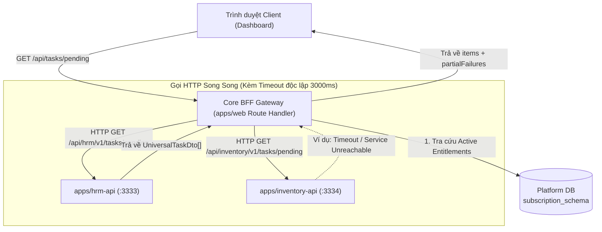

# Kế hoạch & Đặc tả Kỹ thuật: Duyệt Đơn Nhanh Ngoài Dashboard, Lưu Dấu Vết Kiểm Toán & Quản Trị Thuê Bao Đa Phân Hệ

> **Dự án:** Enterprise Platform (SaaS ERP)  
> **Tài liệu:** `docs/plan_core_drawler/04_QUICK_APPROVAL_AUDIT_TRAIL_AND_ENTITLEMENT_PLAN.md`  
> **Mục tiêu:** Đặc tả kiến trúc và giải pháp chi tiết cho việc Duyệt nhanh ngoài Dashboard (Quick Approval), Kiểm soát rủi ro duyệt hàng loạt (Batch Guardrails), Bảo tồn bằng chứng tài liệu kiểm toán (Audit Trail & Evidence Snapshot), Ranh giới cô lập schema (Cross-Schema Isolation), và Quản trị vòng đời thuê bao phân hệ động (Tenant Entitlement Lifecycle).  
> **Trạng thái:** Dự thảo kế hoạch kỹ thuật (Đã cập nhật theo phản biện kiến trúc)  
> **Tài liệu liên quan trong thư mục:**  
> - [README.md](./README.md): Tổng thể kế hoạch Universal Task Drawer  
> - [01_APPROVAL_CONTRACT_SPEC.md](./01_APPROVAL_CONTRACT_SPEC.md): Đặc tả hợp đồng phê duyệt v1  
> - [02_UNIVERSAL_TASK_DRAWER_SPEC.md](./02_UNIVERSAL_TASK_DRAWER_SPEC.md): Đặc tả thành phần Universal Task Drawer  
> - [03_INVENTORY_MODULE_IMPROVEMENT_PLAN.md](./03_INVENTORY_MODULE_IMPROVEMENT_PLAN.md): Kế hoạch nâng cấp phân hệ Nhà kho  

---

## 1. Bối cảnh & Mục tiêu Bài toán

Sau khi triển khai thử nghiệm thành công Universal Task Drawer trên phân hệ HRM (Reference Implementation), hệ thống phát sinh các yêu cầu nghiệp vụ và phản biện kỹ thuật thực tế:

1. **Nhu cầu Duyệt đơn nhanh ngoài Dashboard (Inline & Batch Approval):**
   - Người quản lý có số lượng đơn từ thông thường lớn mỗi ngày (nghỉ phép, giải trình công, làm thêm giờ dưới 4 giờ).
   - Thao tác mở Drawer từng đơn lẻ tuy trực quan nhưng tốn thời gian khi cần xử lý nhanh.
   - Cần cơ chế duyệt nhanh 1-chạm (Inline Quick Action) hoặc duyệt chọn nhiều đơn (Batch Approval) trực tiếp tại Dashboard.

2. **Kiểm soát Rủi ro khi Duyệt Hàng Loạt (Batch Guardrails):**
   - Duyệt nhanh không được trở thành "lối đi tắt" vi phạm quy định hay làm vỡ trách nhiệm kiểm tra.
   - Phải phân định rõ: Đơn nào được phép duyệt nhanh? Đơn nào **bắt buộc** phải mở Drawer xem xét chi tiết?
   - Xử lý tính độc lập của Transaction: Mỗi đơn là một Transaction riêng biệt (không thể all-or-nothing cho cả đợt vì đơn thuộc các phân hệ/database khác nhau).

3. **Bảo tồn Dấu vết Tài liệu (Audit Trail & Evidence Snapshot):**
   - Duyệt nhanh phải có đầy đủ giá trị pháp lý và kiểm toán: *Ai duyệt? Lúc nào? Duyệt từ kênh nào (Dashboard Inline, Batch, hay Drawer)? Tại thời điểm duyệt, các chỉ số tóm tắt của đơn mang giá trị chính xác là gì?*

4. **Kiến trúc Core BFF Gateway & Quản trị Thuê bao Đa Phân hệ (Tenant Entitlements):**
   - Core Web (`apps/web`) **tuyệt đối không import trực tiếp package nghiệp vụ** (`packages/modules/*`) in-process. Core BFF Gateway đóng vai trò HTTP Proxy tổng hợp qua mạng nội bộ.
   - Thích ứng động theo gói thuê bao (`subscription_schema.tenant_entitlements`): Tenant không dùng module nào thì Gateway không truy vấn module đó.
   - Xử lý timeout, lỗi từng phần (`partialFailures`), và chiến lược phân trang liên module thực tế.

---

## 2. Ranh giới Phân hệ & Cơ chế Không Can Thiệp Schema (Rule #4)

### 2.1. Quy tắc Cốt tử (Rule #4)
> **"Tuyệt đối không ghi vào schema của phân hệ khác. Dữ liệu của phân hệ khác lấy qua API, route `/v1/internal/`, hoặc sự kiện Outbox."**

Mỗi tenant sở hữu một cơ sở dữ liệu riêng, bên trong chia tách thành các schema độc lập:
- `core_schema`: Người dùng, sơ đồ tổ chức, vai trò hệ thống, chính sách bảo mật.
- `hrm_schema`: Nhân sự, chấm công, ca làm việc, bảng lương, các loại đơn từ nhân sự.
- `inventory_schema`: Kho hàng, vị trí kho, vật tư, tài sản thiết bị, sổ cái giao dịch xuất/nhập kho.
- `finance_schema`: Phiếu thu, phiếu chi, tài khoản thanh toán, liên kết chứng từ.
- `maintenance_schema`: Máy móc, kế hoạch bảo trì, phiếu công việc sự cố (Work Orders).
- `workspace_schema`: Dự án, nhiệm vụ, tài liệu chia sẻ, yêu cầu phát sinh dự án.
- `procedure_schema`: Định nghĩa quy trình động, phiên chạy quy trình, các bước duyệt.
- `integration_schema`: Bảng `outbox` và `inbox` lưu trữ sự kiện giao tiếp liên module.

### 2.2. Lý do Kỹ thuật cấm can thiệp chéo Schema (Cross-Schema SQL)
1. **Bảo toàn Tính toàn vẹn Nghiệp vụ (Domain Invariants):**
   - Chỉ phân hệ sở hữu schema mới hiểu và kiểm soát toàn bộ ràng buộc nghiệp vụ phức tạp.
   - *Ví dụ:* Phân hệ Kho (`inventory`) quản lý tồn kho theo mô hình sổ cái bất biến (`ledger-only`), khóa bi quan (`pessimistic lock`), và tính toán tồn khả dụng (`available = quantity - quantity_reserved`). Nếu phân hệ Bảo trì hoặc Tài chính tự ý viết lệnh `UPDATE inventory_schema.materials SET quantity = quantity - 1`, toàn bộ kiểm soát số dư và nhật ký kho sẽ bị sai lệch vĩnh viễn.
2. **Không Khóa Ngoại Chéo (No Cross-Schema Foreign Keys):**
   - Giữa các bảng thuộc schema khác nhau không tạo ràng buộc `REFERENCES`. Mọi liên kết chỉ lưu dưới dạng giá trị thô (`UUID` hoặc `code`).
   - Điều này cho phép từng module nâng cấp, thay đổi cấu trúc bảng, chạy migration độc lập, hoặc tách thành database/microservice chuyên biệt trong tương lai mà không bị vướng khóa ngoại DB.

### 2.3. Ba Kênh Giao tiếp Chuẩn mực giữa các Phân hệ
```
┌─────────────────────────────────────────────────────────────────────────────┐
│ KÊNH 1: INTERNAL API (/v1/internal/...)                                     │
│ Đồng bộ, tức thời: Gọi HTTP nội bộ qua Service JWT Token được bảo vệ bởi   │
│ ModuleAccess. Dùng cho truy vấn tra cứu thông tin (Read) hoặc xác thực.     │
├─────────────────────────────────────────────────────────────────────────────┤
│ KÊNH 2: TRANSACTIONAL OUTBOX PATTERN (integration_schema.outbox)             │
│ Bất đồng bộ, đảm bảo tính nhất quán (Eventual Consistency):                │
│ Khi hoàn tất nghiệp vụ, module ghi sự kiện vào outbox TRONG CÙNG GIAO DỊCH │
│ DB. Worker nền đọc sự kiện và phân phối đến các module cần nghe.           │
├─────────────────────────────────────────────────────────────────────────────┤
│ KÊNH 3: PROCEDURE ENGINE ASYMMETRIC LINKS (procedure_links)                │
│ Quy trình phức tạp: Module nghiệp vụ chỉ lưu ID phiên quy trình            │
│ (procedure_instance_id) và lắng nghe sự kiện kết quả duyệt để chuyển trạng  │
│ thái, không đọc trực tiếp bảng của procedure_schema.                       │
└─────────────────────────────────────────────────────────────────────────────┘
```

---

## 3. Kiến Trúc Core BFF Gateway & Phân Phối Tác Vụ Động (HTTP Proxy)

### 3.1. Ranh giới Đóng gói (Tuân thủ README Mục 4 - Điều 10)
> **`apps/web` tuyệt đối KHÔNG import trực tiếp package nghiệp vụ (`packages/modules/*`) trong cùng tiến trình (in-process).**

Thực tế kiến trúc hệ thống:
- Các endpoint `/api/tasks/...` tại `apps/web` đóng vai trò là **BFF Gateway (HTTP Proxy)**.
- Giao tiếp giữa Core BFF Gateway và các phân hệ nghiệp vụ diễn ra qua **giao thức HTTP nội bộ** sử dụng Service Token (Service-to-Service) hoặc chuyển tiếp Cookie/Bearer token của người dùng.
- Mỗi phân hệ chạy độc lập dưới dạng một NestJS application (`apps/hrm-api`, `apps/inventory-api`, `apps/procedure-api`...).



### 3.2. Bảng Endpoint Định danh Phân hệ (Module Endpoint Registry)
Tại Core BFF Gateway, danh mục phân hệ được cấu hình dưới dạng bản đồ URL dịch vụ nội bộ:

```ts
export interface ModuleTaskEndpointConfig {
  readonly moduleKey: string;
  readonly internalBaseUrl: string;
  readonly timeoutMs: number;
}

export const MODULE_TASK_ENDPOINTS: Record<string, ModuleTaskEndpointConfig> = {
  hrm: {
    moduleKey: 'hrm',
    internalBaseUrl: process.env.INTERNAL_HRM_API_URL || 'http://localhost:3333',
    timeoutMs: 3000,
  },
  inventory: {
    moduleKey: 'inventory',
    internalBaseUrl: process.env.INTERNAL_INVENTORY_API_URL || 'http://localhost:3334',
    timeoutMs: 3500,
  },
};
```

### 3.3. Xử lý Timeout & Bắt lỗi Minh bạch (`partialFailures`)
Khi gọi song song nhiều phân hệ, `Promise.allSettled` không được nuốt lỗi im lặng làm nhiệm vụ biến mất khiến người duyệt lầm tưởng là không có việc. Core Gateway bắt buộc phản ánh các phân hệ bị lỗi/timeout:

```ts
export interface TaskPageResultWithFailures {
  items: UniversalTaskDto[];
  total: number;
  partialFailures: Array<{
    moduleKey: string;
    reason: 'TIMEOUT' | 'SERVICE_UNAVAILABLE' | 'FORBIDDEN';
    message: string;
  }>;
}
```
Khi `partialFailures` có dữ liệu, giao diện Dashboard hiển thị một thanh cảnh báo thông báo rõ:
> *"Phân hệ Nhà kho tạm thời không phản hồi. Vui lòng làm mới lại sau."*

### 3.4. Chiến lược Phân trang Đa Phân hệ (Pagination Strategy)
Việc gom toàn bộ dữ liệu từ các service rồi `sort` và `slice` sẽ gây nghẽn nghiêm trọng khi số lượng đơn lớn. Do đó hệ thống phân định rõ:
1. **Trên Widget Dashboard:**
   - Chỉ tải **Top N công việc khẩn cấp nhất** (mỗi module được gọi với `limit=5` hoặc `limit=10`).
   - BFF gộp danh sách nhỏ này lại, sắp xếp theo `createdAt DESC` và hiển thị trực tiếp. Không hỗ trợ phân trang vô tận trên trang chủ Dashboard.
2. **Trên Màn hình Danh sách Đầy đủ (Xem tất cả):**
   - **Chiến lược theo Tab Module (Khuyến nghị số 1):** Cung cấp các tab theo phân hệ (`Tất cả`, `Nhân sự`, `Nhà kho`...). Khi người dùng chọn tab cụ thể, việc phân trang (`offset`, `limit`) được ủy quyền trực tiếp xuống service của phân hệ đó một cách chuẩn xác 100%.
   - **Chiến lược Phân trang Con trỏ (Cursor-based) cho Tab "Tất cả":** Sử dụng cặp con trỏ `(beforeCreatedAt, lastTaskId)` gửi xuống từng module để lấy khối dữ liệu kế tiếp một cách đồng đều.

---

## 4. Vòng Đời Thuê Bao Phân Hệ (Tenant Entitlement Lifecycle)

### 4.1. Nguyên tắc Bảo tồn Dữ liệu Pháp lý
> **Tuyệt đối KHÔNG xóa schema hay dữ liệu của phân hệ khi tenant hết hạn hợp đồng hoặc ngừng gia hạn.**
- **Căn cứ pháp lý:** Luật Kế toán và Thuế yêu cầu doanh nghiệp lưu trữ chứng từ, bảng công, phiếu chi và sổ kho trong tối thiểu 5–10 năm. Việc xóa schema sẽ gây vi phạm pháp luật nghiêm trọng.
- **Tính toàn vẹn tham chiếu:** Các chứng từ ở phân hệ khác từng liên kết tới ID của module này phải luôn tra cứu được thông tin gốc.
- **Khả năng kích hoạt lại (Reactivation):** Doanh nghiệp có thể ngưng vài tháng rồi gia hạn tiếp; giữ nguyên dữ liệu giúp tái khởi động tức thì.

### 4.2. Chu kỳ Vòng đời 3 Giai đoạn (Subscription Lifecycle)

```
[ GIAI ĐOẠN 1: ACTIVE ]
- Module hoạt động bình thường, đầy đủ tính năng tạo mới và phê duyệt.
           │
           ▼ (Đến ngày hết hạn hợp đồng dịch vụ)
[ GIAI ĐOẠN 2: GRACE PERIOD / READ-ONLY (15–30 ngày) ]
- Chặn tạo mới (POST bị cấm).
- Cho phép tra cứu, xem lại lịch sử, xuất báo cáo Excel/PDF để sao lưu.
- Drawer chuyển sang chế độ Chỉ đọc (Read-only), khóa nút Duyệt/Từ chối.
           │
           ▼ (Quá thời hạn ân hạn mà không thanh toán)
[ GIAI ĐOẠN 3: DISABLED / SUSPENDED ]
- subscription_schema.tenant_entitlements chuyển sang status = 'disabled'.
- Cổng ModuleAccess chặn mọi request với mã 403 MODULE_NOT_ENTITLED.
- Phân hệ bị ẩn hoàn toàn khỏi Sidebar và Menu điều hướng.
```

### 4.3. Xử lý Tác vụ Đang Chờ Duyệt (`PENDING`) của Phân hệ Hết hạn
1. **Loại khỏi Danh sách Việc cần xử lý trên Dashboard:**
   - Core Gateway kiểm tra `tenant_entitlements`, nếu module mang trạng thái `disabled`, Gateway loại bỏ endpoint của phân hệ đó khỏi truy vấn tổng hợp. Người duyệt không thấy các việc này trong danh sách khẩn cấp.
2. **Đóng băng An toàn (Frozen / Suspended State):**
   - Các đơn từ trong database của module vẫn giữ nguyên trạng thái `PENDING` (hoặc đánh dấu cờ `SUSPENDED`).
3. **Mở qua Liên kết Cũ (Deep Link / Archive View):**
   - Nếu truy cập link trực tiếp, Universal Task Drawer chuyển sang **Chế độ Lưu trữ Chỉ đọc (Archived Read-only Mode)**:
     - Header hiển thị Banner: `Phân hệ đã hết hạn dịch vụ · Dữ liệu được lưu trữ ở chế độ Chỉ đọc để tra cứu.`
     - Trường `availableActions: []`. Toàn bộ nút Duyệt / Từ chối bị vô hiệu hóa.
4. **Khôi phục Tức thời khi Gia hạn Lại (Reactivation):**
   - Khi tenant thanh toán, Platform Admin đổi trạng thái `tenant_entitlements` về `active`.
   - Ngay lập tức: Module xuất hiện lại trên Menu, các đơn `PENDING` dở dang tự động nổi lại trên Dashboard, các nút hành động trong Drawer sáng trở lại và tiếp tục luồng duyệt bình thường.

---

## 5. Chuẩn Hóa Cấu Trúc 5 Khối & Phạm Vi Hợp Đồng

### 5.1. Phạm vi Hợp đồng Hiện tại (Cam kết Triển khai)
Theo đúng quy hoạch tại [README.md](./README.md) (Mục 5), hiện tại hệ thống chỉ chính thức cam kết hợp đồng cho 2 phân hệ:
1. **Phân hệ Nhân sự (HRM):** Reference Implementation với đầy đủ 4 loại đơn: Nghỉ phép (`LEAVE_REQUEST`), Làm thêm giờ (`OT_REQUEST`), Giải trình công (`ATTENDANCE_CORRECTION_REQUEST`), Công tác (`BUSINESS_TRIP_REQUEST`).
2. **Phân hệ Nhà kho (Inventory):** Chỉ tích hợp đúng 2 loại tác vụ đủ điều kiện duyệt tại Drawer:
   - `STOCK_EXPORT_REQUEST` (Phiếu xuất kho cấp phát vật tư) - Mã `XK-...`
   - `STOCKTAKE_DISCREPANCY` (Biên bản kiểm kê kho chênh lệch) - Mã `KK-...`

| Phân hệ | Loại tác vụ / Mã | Khối 1: Tóm tắt (`summary`) | Khối 2: Chi tiết (`attributes`) | Khối 3: Bảng kê (`table`) | Khối 4 & 5 (`attachments`, `timeline`) |
| :--- | :--- | :--- | :--- | :--- | :--- |
| **HRM** | Nghỉ phép (`NP-...`) | Loại phép, Thời gian nghỉ, Số ngày nghỉ | Lý do nghỉ, Người nhận bàn giao, Ghi chú | — *(Tự động ẩn)* | Giấy khám bệnh (nếu có), Tiến trình duyệt |
| **HRM** | Làm thêm giờ (`OT-...`) | Ngày làm thêm, Khung giờ (`HH:mm – HH:mm`), Thời lượng OT, Chế độ lương | Lý do/Công việc thực hiện, Kế hoạch chi tiết | — *(Tự động ẩn)* | Tiến trình duyệt |
| **HRM** | Giải trình công (`GT-...`) | Ngày cần giải trình, Giờ vào đề nghị (`HH:mm`), Giờ ra đề nghị (`HH:mm`) | Căn cứ điều chỉnh, **Giờ đã chấm trong ngày** (`Vào: ... · Ra: ...`), Mô tả | — *(Tự động ẩn)* | Ảnh chụp log máy chấm công, Tiến trình duyệt |
| **HRM** | Công tác (`CT-...`) | Địa điểm, Thời gian, Số ngày công tác | Mục đích công tác, Kế hoạch di chuyển | Bảng kê dự toán công tác phí (nếu có) | Giấy mời công tác, Tiến trình duyệt |
| **Kho (`inventory`)** | Xuất kho (`STOCK_EXPORT_REQUEST`) | Kho xuất, Mục đích xuất, Tổng mặt hàng, Ngày cần hàng | Căn cứ đề xuất, Mã dự án/máy móc, Địa điểm nhận, Ghi chú vận chuyển | **Bảng kê vật tư:** SKU, Tên, ĐVT, Tồn khả dụng, SL yêu cầu | Phiếu kiểm tra hiện trường, Tiến trình duyệt |
| **Kho (`inventory`)** | Kiểm kê chênh lệch (`STOCKTAKE_DISCREPANCY`) | Kho kiểm kê, Ngày kiểm kê, Tổng giá trị chênh lệch | Loại kiểm kê, Trưởng đoàn kiểm kê, Phương án xử lý hao hụt | **Bảng chênh lệch:** Tên hàng, Tồn hệ thống, Tồn thực tế, SL lệch | Biên bản kiểm kê thực tế, Tiến trình duyệt |

### 5.2. Định Hướng Thiết Kế Tham Khảo Cho Các Phân Hệ Khác (Không coi là Hợp đồng Cam kết)
Các phân hệ dưới đây chỉ là kịch bản định hướng mở rộng tiềm năng, **chưa nằm trong phạm vi hợp đồng kỹ thuật hiện tại**:
- **Tài chính (`finance`):** Phiếu chi (`PC-...`) với số tiền, phương thức, đợt thanh toán, hóa đơn VAT.
- **Bảo trì (`maintenance`):** Phiếu nghiệm thu sự cố (`BT-...`) với thiết bị, nguyên nhân, phụ tùng thay thế từ Kho.
- **Dự án (`workspace`):** Đề xuất phát sinh ngân sách (`DA-...`) với hạng mục bổ sung, tác động tiến độ.
- **Mua sắm (`procurement`):** Đơn đặt hàng (`PO-...`) với nhà cung cấp, bảng so sánh báo giá 3 bên.

---

## 6. Kiểm Soát Rủi Ro Khi Duyệt Hàng Loạt (Batch Approval Guardrails)

Duyệt hàng loạt ngoài Dashboard là tính năng tiện lợi nhưng tiềm ẩn rủi ro nghiệp vụ cao nếu không được kiểm soát chặt chẽ. Hệ thống thiết lập các quy tắc bắt buộc sau:

### 6.1. Mỗi Đơn là Một Giao Dịch Độc Lập (Independent Transaction)
> **Tuyệt đối KHÔNG áp dụng mô hình "All-or-Nothing" cho toàn bộ đợt duyệt hàng loạt.**
- Các đơn trong danh sách chọn có thể thuộc các phân hệ khác nhau (HRM, Kho...), nằm ở các schema hoặc database khác nhau. Không thể có một transaction SQL chung bao bọc toàn bộ.
- Core Gateway gọi thực thi từng đơn độc lập.
- Kết quả trả về chi tiết theo từng đơn (`results: [{ taskId, success, error }]`), cho phép một phần thành công và một phần thất bại (ví dụ: đơn 1 thành công, đơn 2 thất bại do xung đột phiên bản).

### 6.2. Tuyệt Đối CẤM Chức Năng Batch `REJECT` (Chống Lối Đi Tắt)
- Theo quy định tại [README.md](./README.md) (Mục 4 - Điều 3): *"Mọi hành động Từ chối (REJECT) hoặc Yêu cầu bổ sung (RETURN) bắt buộc phải có nội dung văn bản lý do cụ thể."*
- Việc từ chối hàng loạt bằng một `globalReason` chung là lối đi tắt phản cảm và phi lý trong quản trị nhân sự/nghiệp vụ.
- **Quy tắc:**
  - **Chỉ cho phép Batch `APPROVE`**.
  - **Bỏ hoàn toàn nút `[Từ chối hàng loạt]` ở thanh thao tác nổi.**
  - Khi muốn Từ chối hoặc Yêu cầu chỉnh sửa, người duyệt **bắt buộc phải mở Drawer của từng đơn** để ghi rõ lý do xác đáng cho người nộp.

### 6.3. Giới Hạn & Phân Loại Đơn Đủ Điều Kiện Batch Approve
1. **Ngưỡng số lượng an toàn:** Giới hạn tối đa **20 đơn / lần duyệt** để tránh nghẽn thread xử lý và quá tải worker.
2. **Chỉ áp dụng cho đơn chuẩn hóa, đủ thông tin tại Khối Tóm tắt:**
   - Được phép batch approve: Đơn nghỉ phép (`LEAVE_REQUEST`), Đơn làm thêm giờ (`OT_REQUEST` dưới 4 giờ).
3. **CẤM Batch Approve đối với đơn có Bảng kê phức tạp hoặc Giá trị lớn:**
   - Đơn xuất kho (`STOCK_EXPORT_REQUEST`), Biên bản kiểm kê (`STOCKTAKE_DISCREPANCY`), Đơn tạm ứng lương giá trị cao **bắt buộc phải mở Drawer** xem chi tiết danh mục vật tư/số liệu trước khi duyệt.
   - Trên bảng Dashboard, Checkbox của các đơn này bị vô hiệu hóa (disabled) kèm chú thích (Tooltip): *"Đơn có bảng kê chi tiết, vui lòng mở Drawer để kiểm tra trước khi phê duyệt."*

### 6.4. Kiểm Tra Quyền Nghiêm Ngặt tại Phân Hệ Chủ (Rule 2)
Endpoint batch tại Core Gateway chỉ kiểm tra người dùng có phiên hợp lệ (`tenant-user`). Mỗi khi dispatch yêu cầu duyệt tới từng phân hệ con, phân hệ chủ bắt buộc phải thực thi kiểm tra thẩm quyền tại server của mình qua `assertCanDecide()` (chống tự duyệt, kiểm tra chuỗi báo cáo và quyền hạn nghiệp vụ).

---

## 7. Cơ Chế Lưu Dấu Vết Tài Liệu & Bảo Tồn Bằng Chứng (Audit Trail)

### 7.1. Chụp Bản Snapshot Bằng Chứng tại Thời Điểm Duyệt (Evidence Freeze)
- Khi người duyệt bấm duyệt, Backend phân hệ tự động chụp lại bản snapshot JSON của **Khối Tóm tắt (`summary`)** và mã băm toàn vẹn (Digest Hash) của **Khối Bảng kê (`table`)**:
  ```json
  {
    "taskId": "inventory:export:xk-0021",
    "revisionAtApproval": 2,
    "evidenceSnapshot": {
      "summary": [
        { "label": "Kho xuất", "value": "Kho Linh Kiện B" },
        { "label": "Tổng mặt hàng", "value": "3 mã (12 chiếc)" }
      ],
      "tableHash": "sha256_e3b0c44298fc1c149afbf4c8996fb92427ae41e4649b934ca495991b7852b855"
    }
  }
  ```
  Bản snapshot này được ghi vĩnh viễn vào nhật ký duyệt và không thể sửa đổi, làm bằng chứng pháp lý khi kiểm toán.

### 7.2. Kiểm Soát Xung Đột Phiên Bản (Optimistic Locking & Revision Check)
- Mọi thao tác duyệt gửi lên bắt buộc kèm trường `revision` (phiên bản dữ liệu tại thời điểm hiển thị trên màn hình người duyệt).
- Câu lệnh cập nhật trạng thái trong database bắt buộc kiểm tra:
  ```sql
  UPDATE hrm_schema.leave_requests
     SET status = 'APPROVED', revision = revision + 1, updated_at = now()
   WHERE id = $id AND revision = $expectedRevision AND status = 'PENDING'
  RETURNING *;
  ```
- Nếu đơn vừa bị nhân viên chỉnh sửa trước đó vài giây, câu lệnh trả về 0 dòng, hệ thống lập tức từ chối lệnh duyệt và thông báo: *"Dữ liệu đơn đã bị thay đổi trước thời điểm bạn phê duyệt. Vui lòng làm mới trang để kiểm tra lại."*

### 7.3. Chống Bấm Đúp và Trùng Lặp Yêu Cầu (`idempotencyKey`)
Mọi lệnh duyệt đơn lẻ hoặc hàng loạt đều sinh mã UUID `idempotencyKey` tại Client trước khi gửi request. Nếu người dùng click đúp hoặc mạng chập chờn gửi lại request, Backend chỉ xử lý đúng 1 lần duy nhất.

### 7.4. Phân Định Kênh Quyết Định (Decision Source Channel Tracking)
Trong bảng nhật ký trao đổi và quyết định của phân hệ (ví dụ [hrm_schema.request_comments](../../migrations/tenant/hrm/0050-hrm-request-comments.sql)), hệ thống bổ sung cột `channel`:
- `author_user_id`: ID người duyệt.
- `author_name`: Tên người duyệt.
- `decision`: `APPROVE`.
- `channel`:
  - `DASHBOARD_INLINE`: Duyệt nhanh 1-chạm ngoài bảng Dashboard.
  - `DASHBOARD_BATCH`: Duyệt qua chức năng chọn hàng loạt.
  - `TASK_DRAWER`: Duyệt trong Universal Task Drawer.
  - `MODULE_DETAIL`: Duyệt trong màn hình chuyên sâu của phân hệ.
- `body`: Ý kiến hoặc lý do phê duyệt đính kèm.

> **Lưu ý Migration:** Bảng `hrm_schema.request_comments` hiện tại (tạo từ migration `0050`) chưa có cột `channel`. Theo quy tắc `AGENTS.md` và skill `erp-migrations`, tuyệt đối không sửa file cũ mà phải **tạo file migration mới** (ví dụ `0075-hrm-request-comment-channel.sql`) bổ sung cột `channel varchar(30) DEFAULT 'TASK_DRAWER'`.

---

## 8. Đặc Tả Hợp Đồng API Mở Rộng (`packages/contracts/task-approval`)

### 8.1. Mở rộng `ExecuteTaskActionDto`
Bổ sung các trường phục vụ kiểm soát xung đột và dấu vết kiểm toán trong [task-actions.ts](../../packages/contracts/task-approval/src/lib/task-actions.ts):
```ts
export type TaskActionChannel =
  | 'DASHBOARD_INLINE'
  | 'DASHBOARD_BATCH'
  | 'TASK_DRAWER'
  | 'MODULE_DETAIL';

export interface ExecuteTaskActionDto {
  action: TaskActionType;
  reason?: string;
  idempotencyKey: string;
  
  /** Phiên bản dữ liệu tại thời điểm người duyệt bấm nút (chống sửa trộm) */
  revision?: number;

  /** Kênh thao tác để lưu vết kiểm toán */
  channel?: TaskActionChannel;

  /** Ảnh chụp các chỉ số cốt lõi lúc bấm duyệt (dùng cho thanh tra đối chiếu) */
  evidenceSnapshot?: Record<string, any>;
}
```

### 8.2. Đặc tả Endpoint Duyệt Hàng Loạt (Batch Actions)
- **Đường dẫn:** `POST /api/tasks/batch-actions` (Xử lý tại Core BFF Router).
- **Quyền hạn yêu cầu:** Người dùng đăng nhập có phiên hợp lệ (`tenant-user`).
- **Cấu trúc Request Body:**
  ```json
  {
    "tasks": [
      {
        "taskId": "hrm:leave:c0195fb2-3073-445c-9768-b6d3aabaa7a8",
        "action": "APPROVE",
        "revision": 2,
        "idempotencyKey": "9b1deb4d-3b7d-4bad-9bdd-2b0d7b3dcb6d"
      },
      {
        "taskId": "hrm:ot:50458af3-5149-42f0-ab6f-6bd263dbd939",
        "action": "APPROVE",
        "revision": 1,
        "idempotencyKey": "e4d29a5f-1a8e-4a62-8e12-4f36a5b281f9"
      }
    ],
    "globalReason": "Phê duyệt nhanh các đề xuất hợp lệ ngày 27/10",
    "channel": "DASHBOARD_BATCH"
  }
  ```
- **Cấu trúc Response:**
  ```json
  {
    "success": true,
    "totalRequested": 2,
    "succeededCount": 2,
    "failedCount": 0,
    "results": [
      {
        "taskId": "hrm:leave:c0195fb2-3073-445c-9768-b6d3aabaa7a8",
        "success": true,
        "action": "APPROVE",
        "newStatus": "APPROVED",
        "message": "Phê duyệt đơn thành công"
      },
      {
        "taskId": "hrm:ot:50458af3-5149-42f0-ab6f-6bd263dbd939",
        "success": true,
        "action": "APPROVE",
        "newStatus": "APPROVED",
        "message": "Phê duyệt đơn làm thêm giờ thành công"
      }
    ]
  }
  ```

---

## 9. Kế Hoạch & Lộ Trình Triển Khai (Roadmap)

Kế hoạch được chia thành 4 sprint rõ ràng:

### Sprint 1: Nâng cấp Contracts DTO, Migration & Audit Snapshot Backend
- Bổ sung `channel`, `revision`, `evidenceSnapshot` vào `ExecuteTaskActionDto` trong `packages/contracts/task-approval`.
- Tạo migration mới `0075-hrm-request-comment-channel.sql` bổ sung cột `channel` vào bảng `hrm_schema.request_comments` theo chuẩn `erp-migrations`.
- Cập nhật hàm `executeAction` của `HrmTaskApprovalService` để ghi nhận `channel`.
- Viết unit tests kiểm thử kiểm soát xung đột phiên bản `revision` (trả về `409 Conflict` nếu revision không khớp).

### Sprint 2: Core Task Gateway HTTP Proxy & Dynamic Entitlements
- Xây dựng bản đồ endpoint nội bộ `MODULE_TASK_ENDPOINTS` tại `apps/web/src/app/api/tasks/`.
- Tích hợp tra cứu `subscription_schema.tenant_entitlements` để Gateway chỉ gửi HTTP request tới các module mà tenant đang kích hoạt thuê bao hợp lệ.
- Xử lý timeout độc lập (3000ms) và trả về `partialFailures` minh bạch khi có phân hệ lỗi.
- Xây dựng handler xử lý `POST /api/tasks/batch-actions` (chỉ cho phép `action === 'APPROVE'`, từ chối đơn có bảng kê phức tạp).

### Sprint 3: UI Dashboard Inline Quick Action
- Bổ sung cột Thao tác trên bảng Dashboard ([dashboard-pending-tasks-table.tsx](../../apps/web/src/app/(tenant)/dashboard/dashboard-pending-tasks-table.tsx)).
- Tích hợp Popover xác nhận duyệt nhanh đơn lẻ kèm ô nhập ghi chú nhanh.
- Cập nhật trạng thái Optimistic UI và bắn sự kiện `ep:task-action-completed` để đồng bộ lại badge số lượng công việc chờ duyệt trên thanh tiêu đề.

### Sprint 4: UI Dashboard Batch Multi-Approval & Continuous Drawer Approval
- Bổ sung Checkbox chọn nhiều dòng trên Dashboard và thanh Floating Action Bar cố định ở mép dưới màn hình.
- Disable checkbox đối với các đơn có bảng kê phức tạp (Kho, Tạm ứng lớn) kèm tooltip hướng dẫn.
- Bổ sung nút `[Duyệt & Chuyển đơn kế tiếp]` vào Footer của `UniversalTaskDrawer`.
- Kiểm thử toàn diện End-to-End với các kịch bản: Duyệt đơn HRM, Xử lý khi đơn bị sửa đổi trước khi duyệt, và Hiển thị cảnh báo khi phân hệ bị timeout.
