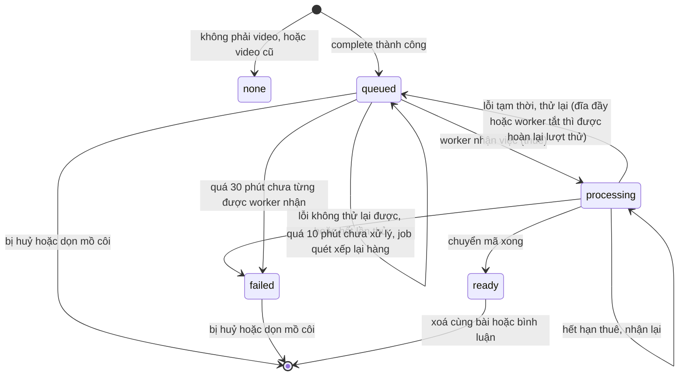

# Video trong Mạng nội bộ (social)

Tài liệu kiến trúc cho video đính kèm bình luận và bài đăng. Vận hành hằng ngày: `docs/social-video-runbook.md`.
Cách chạy worker: `apps/video-worker/README.md`. Nguồn thật của mọi giới hạn:
`packages/contracts/social/src/lib/contracts-social.ts`.

## 1. Tổng quan

Người dùng chọn video trong ô soạn bình luận hoặc bài đăng. Trình duyệt tải thẳng lên MinIO bằng URL ký; server không
nhận byte video. Sau khi tải xong, video được chuyển mã ở nền bởi container riêng `video-worker` sang MP4 H.264 + AAC
(`faststart`), kèm ảnh poster JPEG. Bản gốc bị xoá ngay sau khi chuyển mã. Người xem phát thẳng từ MinIO bằng URL ký
(hỗ trợ Range, TTL 1 giờ), không đi qua API.

## 2. Luồng xử lý

```mermaid
sequenceDiagram
    autonumber
    participant B as Trình duyệt
    participant A as social-api
    participant M as MinIO
    participant O as Outbox và relay (apps/worker)
    participant R as RabbitMQ
    participant V as video-worker

    B->>A: Xin URL tải lên (khai kích thước, kiểu, mục đích)
    A->>A: Kiểm hạn mức, quota tenant, rate limit
    A-->>B: URL ký (một PUT, hoặc nhiều phần nếu lớn hơn 10 MB)
    B->>M: PUT thẳng lên MinIO (phần 8 MiB, 3 song song, thử lại từng phần)
    B->>A: complete
    A->>M: Kiểm kích thước và chữ ký tệp
    A->>O: Đặt queued và ghi sự kiện (cùng một transaction)
    O->>R: Relay đẩy sang hàng comment hoặc post
    R->>V: Giao việc (prefetch 1 mỗi hàng)
    V->>V: Thuê việc, đặt processing
    V->>M: Tải bản gốc xuống đĩa
    V->>V: ffprobe kiểm tra, ffmpeg chuyển mã, tạo poster
    V->>M: Tải bản mới và poster lên
    V->>V: Cập nhật ready (hoặc failed)
    V->>M: Xoá bản gốc
    V->>R: ack
    B->>A: Hỏi trạng thái; đăng bài hoặc gửi bình luận bất cứ lúc nào sau khi tải xong (chưa ready thì có cảnh báo)
    B->>M: Phát bằng URL ký (Range)
```

### Trạng thái (`social_schema.attachments.processing_status`)



Cột liên quan: `purpose`, `processing_attempts`, `processing_lease_until`, `processing_error`, `source_key`,
`poster_key`, `duration_ms`, `width`, `height` (migration `migrations/tenant/social/0007-social-video-processing.sql`).

## 3. Giới hạn

| Mục | Bình luận | Bài đăng |
|---|---|---|
| Dung lượng tải lên | 300 MB | 1 GB |
| Thời lượng | 180 giây | 600 giây |
| Số video | 1 | 3 |
| Cạnh ngắn đầu ra tối đa | 720 (ngang 1280x720, dọc 720x1280) | 1080 (ngang 1920x1080, dọc 1080x1920) |
| Bitrate hình tối đa | 2500 kbps | 4000 kbps |

Chung cho cả hai:

| Mục | Giá trị |
|---|---|
| Định dạng nhận | mp4, webm, mov (iPhone HEVC được chuyển mã) |
| Cạnh dài đầu vào tối đa | 4096 (8K bị từ chối) |
| Độ phân giải đầu ra | cạnh ngắn = nhỏ hơn giữa nguồn và trần, không phóng to; video dọc có cùng số điểm ảnh với video ngang |
| Tải lên | chia phần khi lớn hơn 10 MB: phần 8 MiB, 3 song song |
| Trần thời gian chuyển mã | 20 phút (RabbitMQ chờ ack 30 phút) |
| Tổng dung lượng tệp chưa gắn mỗi người | 2 GB |
| Video chờ hoặc đang xử lý | 3 mỗi người, 6 mỗi tenant |
| TTL URL xem | 1 giờ |

Nguồn: `SOCIAL_VIDEO_LIMITS`, `SOCIAL_VIDEO_MAX_*`, `SOCIAL_MAX_UNATTACHED_BYTES_PER_USER`, `SOCIAL_MULTIPART_*`,
`SOCIAL_VIDEO_URL_TTL_SECONDS`. Khi đổi hằng số, cập nhật bảng này.

## 4. Hai hàng đợi

| Hàng | Dùng cho | Prefetch |
|---|---|---|
| `social.video.comment.v1` | video bình luận | 1 |
| `social.video.post.v1` | video bài đăng | 1 |

Tối đa 2 luồng chuyển mã cùng lúc trong một container. Lý do tách: video bình luận ngắn (tối đa 3 phút, 720p) không phải
chờ sau video bài đăng dài (tối đa 10 phút, 1080p). Loại sự kiện: `social.video.comment_requested`,
`social.video.post_requested`; không đổi tên sau khi đã phát (skill `erp-events`).

## 5. Đăng khi video chưa xong

- Bấm Đăng hoặc Gửi lúc video còn đang tải lên, `queued` hoặc `processing` thì hiện hộp cảnh báo "Video chưa xử lý xong"
  và người dùng vẫn đăng được ("Vẫn đăng"/"Vẫn gửi") hoặc chọn "Chờ video xong".
- Video đã tải xong nhưng đang xử lý: được đăng kèm. Người xem thấy khung "Video đang được xử lý, sẽ xem được sau ít
  phút" và khung tự cập nhật (hỏi lại sau 8 giây, giãn dần tới 30 giây, tối đa khoảng 30 phút) khi video xong.
- Video còn đang tải lên (byte chưa lên hết): bài/bình luận được đăng KHÔNG kèm video đó (video bị huỷ). Bình luận không
  chữ mà chỉ có video đang tải thì không gửi được.
- Video `failed` (ở ô soạn hoặc sau khi đã đăng) không gắn được: server từ chối bằng mã `SOCIAL_VIDEO_FAILED`; giao diện
  yêu cầu gỡ video. Video bị `failed` sau khi đã đăng hiện "Không xử lý được video này"; tác giả sửa bài để gỡ.
- Không có bản nháp: video chưa tải xong thì phải ở lại trang, rời trang là bỏ video đó.

## 6. Dọn tệp

| Tình huống | Cách xử lý |
|---|---|
| Đóng tab, tải lại, rời ô soạn | Trình duyệt gửi `POST /attachments/:id/discard` bằng fetch `keepalive`; có hộp thoại xác nhận `beforeunload` |
| Yêu cầu discard không đến được (treo máy, mất mạng, tắt tab trên điện thoại) | Job dọn dự phòng xoá tệp mồ côi sau 2 giờ, chạy khoảng 15 phút một lần |
| Tải nhiều phần dang dở | Cùng ngưỡng 2 giờ: job huỷ phiên tải nhiều phần rồi xoá dòng. Tải 1 GB phải kịp xong trong 2 giờ kể từ lúc bắt đầu (khoảng 1,2 Mbps liên tục trở lên) |
| Xoá bản gốc hỏng sau chuyển mã | Cột `source_key` còn giá trị; job thử lại xoá |
| Tin nhắn vào hàng chết (lỗi tạm thời kéo dài, ví dụ đĩa đầy), worker chết, hoặc `video-worker` không chạy làm video kẹt `queued`/`processing` | Job quét (mỗi 5 phút, ở `apps/worker`): video `queued` quá 10 phút hoặc `processing` đã hết hạn thuê được xếp lại hàng qua outbox (gửi trùng vô hại vì chỉ một worker nhận được việc); video `queued` quá 30 phút mà chưa từng được nhận thì chuyển `failed` kèm "Hệ thống xử lý video chưa sẵn sàng. Hãy tải video lên lại sau." và xoá bản gốc |
| Xoá bài hoặc bình luận | Xoá ngay video, poster, bản gốc |

Server chỉ xoá tệp chưa gắn vào bài hoặc bình luận.

## 7. Mô hình bảo mật

- Ghim độ dài: URL ký có `content-length`, tệp tải lên phải đúng số byte đã khai.
- Chữ ký tệp (magic bytes) kiểm lúc `complete`; không tin `content-type` do client khai.
- Quota dung lượng tenant kiểm khi xin URL; có rate limit và nhật ký tải lên.
- ffmpeg chặn giao thức mạng (chỉ đọc tệp cục bộ), để tệp độc hại không gọi ra ngoài.
- Chỉ giữ một luồng hình và một luồng tiếng; các luồng khác (phụ đề, dữ liệu, tệp đính kèm) bị bỏ.
- Không giữ bản gốc: giảm bề mặt lưu trữ, đổi lại chuyển mã lỗi thì phải tải lại.
- Quyền xem: API cấp URL ký sau khi kiểm quyền; ai đã có URL thì xem được tới khi hết hạn (xem mục 9).

## 8. Nhật ký

Một dòng JSON, không ghi tên tệp.

| Sự kiện | Nơi phát |
|---|---|
| `social.upload.initiated`, `completed`, `rejected`, `aborted`, `discarded` | social-api |
| `social.video.started`, `ready`, `failed`, `retry`, `discarded`, `skipped` | video-worker |
| `social.video_worker.started`, `stopping` | video-worker |
| `social.video.sweep` (số video xếp lại, số video báo lỗi) | apps/worker |

Trường: `tenantId`, `attachmentId`, `purpose`, `attempt`, `outcome`, `durationMs`, `inputBytes`, `outputBytes`,
`outputHeight`, `reason`.

## 9. Hạn chế đã biết

- Hàng đợi xếp hàng nên lúc đông người đăng video sẽ chờ lâu.
- Quota kiểm theo dung lượng gốc lúc xin URL, không theo dung lượng sau chuyển mã.
- Chỉ một độ phân giải đầu ra; chưa có HLS hay CDN.
- HDR/10-bit chuyển về 8-bit, màu có thể nhạt.
- Worker chết giữa chừng thì việc chạy lại từ đầu, không tiếp tục.
- Không giữ bản gốc nên chuyển mã lỗi thì người dùng phải tải lại.
- Rate limiter của social-api nằm trong bộ nhớ từng tiến trình; chạy nhiều bản thì hạn mức nhân lên.
- Người xem đang giữ URL ký vẫn xem được tới khi hết hạn dù video đã bị xoá hoặc bị thu hồi quyền.
- Video chưa tải xong (byte chưa lên hết) thì phải ở lại trang; sau khi tải xong có thể đăng ngay, không phải chờ chuyển mã.
- Bài đăng kèm video đang xử lý hiện khung "Đang xử lý" cho người xem tới khi video xong; nếu `video-worker` không chạy, video bị đánh `failed` sau 30 phút kể từ lúc tải xong (cộng tối đa 5 phút chờ chu kỳ quét).
- Trần "3 video mỗi người, 6 mỗi tenant" và trần 2 GB tệp chưa gắn kiểm rồi mới ghi (không atomic): hai lần `complete` song song sát biên có thể cùng lọt qua.
- Tải 1 GB phải kịp xong trong 2 giờ kể từ lúc bắt đầu (khoảng 1,2 Mbps liên tục trở lên), nếu không job dọn coi là mồ côi.
- Trang khôi phục từ bfcache sau khi đã discard vẫn hiện video dù server đã xoá.
- Worker ghi kết quả đúng lúc người dùng xoá bình luận có thể làm sót tệp mới (cửa sổ rất nhỏ).
- Anamorphic (pixel không vuông) chưa được xử lý riêng; kích thước lẻ làm tròn xuống số chẵn, lệch tỉ lệ tối đa 1 px.
- Relay outbox nằm ở `apps/worker`; worker đó dừng thì video không được đưa vào hàng.

## 10. Công suất và khi nhiều tenant

### Công thức

| Đại lượng | Công thức | Ví dụ |
|---|---|---|
| Thời gian chuyển mã | thời lượng / hệ số thời gian thực | 10 phút ở hệ số 1,0 thì khoảng 10 phút |
| Dung lượng lưu | bitrate x thời lượng | 2,5 Mbps ~ 19 MB/phút; 4 Mbps ~ 30 MB/phút (chưa tính tiếng) |
| Số luồng xem | đường ra / bitrate | 160 Mbps / 2,5 Mbps = 64 lý thuyết |
| Công suất chuyển mã | số luồng x hệ số thời gian thực x 60 | 2 x 1,0 x 60 = 120 phút video mỗi giờ |

### Bảng ví dụ (ước tính, chưa đo)

| Giả định | Kết quả ước tính |
|---|---|
| 1 video bình luận 3 phút, hệ số 1,0 | khoảng 3 phút chuyển mã, ~57 MB lưu |
| 1 video bài đăng 10 phút, hệ số 1,0 | khoảng 10 phút chuyển mã, ~300 MB lưu |
| 30 video bình luận 3 phút cùng lúc (1 luồng bình luận) | khoảng 90 phút để hết hàng |
| Đo thật trên máy dev Windows, 2 luồng ffmpeg, hình thử nhiều nhiễu (thiên về chậm) | 720p: 2,5-3,4 lần thời gian thực; 1080p: 1,44 lần; ~16 MB/phút (720p), ~30 MB/phút (1080p) |
| Đo thật: tải 320 MiB (nhiều phần) rồi chuyển mã video 10 giây | worker xử lý 7 giây, RAM đỉnh của tiến trình worker 72 MB (ffmpeg tính riêng); thư mục tạm sạch sau đó |
| Xem đồng thời 720p, đường ra 160 Mbps dùng chung | khoảng 30-40 luồng thực tế |

### Công bằng giữa tenant

Mỗi người tối đa 3 video chờ hoặc đang xử lý, mỗi tenant tối đa 6, để một bên đăng hàng loạt không chiếm hết worker.
Hàng RabbitMQ là chung cho mọi tenant, không có ưu tiên theo tenant.

### Đòn bẩy khi lớn lên

1. Thêm bản `video-worker` (RabbitMQ tự chia việc), kèm trần CPU tương ứng, hoặc đặt trên máy khác.
2. Tăng `VIDEO_WORKER_*_CONCURRENCY` cẩn thận (VPS dùng chung với hơn 12 ứng dụng khác).
3. CDN trước MinIO để bỏ nút cổ chai đường ra.
4. HLS nhiều độ phân giải (hạng mục P3, chưa làm).
5. Theo dõi dung lượng đĩa, quota và độ dài hàng.

### Cần đo thật

Mọi số trong mục này là ước tính cho tới khi đo bằng `tools/load-test/benchmark-ffmpeg.mjs`: hệ số thời gian thực thật
trên VPS, RAM và CPU đỉnh, thời gian chờ hàng khi tải cao, số luồng xem thật. Số liệu hạ tầng (10 CPU, 18 GB RAM, đĩa
365 GB còn khoảng 100 GB, đường ra ~160 Mbps, vào ~336 Mbps) là kết quả speedtest, chỉ để tham khảo.

## 11. Các ca test chính

| Ca | Nơi chạy |
|---|---|
| Kế hoạch chuyển mã (cạnh ngắn, bitrate, không phóng to), phân tích ffprobe | Jest, `domain/video-transcode-plan.spec.ts`, `domain/video-probe.spec.ts`; `domain/video-transcode.integration.spec.ts` chạy ffmpeg thật nếu có |
| Dịch vụ xử lý video: thuê, thử lại, hết lần thử, huỷ, hoàn lượt thử, xoá bản gốc | Jest, `application/social-video-processing.service.spec.ts` |
| Hàng đợi trên Postgres thật: nhận việc đồng thời (đúng 1 thắng), hết hạn thuê, xếp lại video kẹt, outbox idempotent | `social-video.integration.spec.ts` (đặt `SOCIAL_TEST_ADMIN_URL`) |
| Xoá bài xoá dòng và object của tệp bài và tệp bình luận | `social-postgres.integration.spec.ts` |
| Job dọn: ngưỡng 2 giờ, huỷ phần tải dở, bản gốc sót, xếp lại video kẹt | `application/social-attachment-cleanup.spec.ts` |
| Chặn đăng hoặc gửi khi video chưa `ready` (`SOCIAL_VIDEO_NOT_READY`) | Jest (application) |
| Hạn mức mỗi người và tenant, quota, ghim độ dài, chữ ký tệp | Jest (application) |
| Tải multipart, thử lại phần, URL phần hết hạn | Kiểm thủ công trên giao diện; `tools/load-test` |
| Đóng tab giữa chừng gọi discard; dọn mồ côi sau 2 giờ | Kiểm thủ công trên giao diện; Jest cho job dọn |
| Chuyển mã mp4, webm, mov HEVC, HDR; 8K bị từ chối | `tools/load-test` (fixtures) |
| Tải đồng thời, độ dài hàng, công suất | `tools/load-test` |
| Hệ số thời gian thực của ffmpeg | `tools/load-test/benchmark-ffmpeg.mjs` |
| Hộp cảnh báo khi đăng lúc video chưa xong, huỷ video đang tải rồi đăng, khung "Đang xử lý" và tự cập nhật cho người xem | Jest, `packages/features/social/src/lib` (`video-publish-gate.spec.ts`, `components/comment-input-video-gate.spec.tsx`, `use-video-refresh-poll.spec.tsx`, `components/video-attachment.spec.tsx`) |
| Đăng được khi video queued/processing, từ chối khi failed (`SOCIAL_VIDEO_FAILED`), SQL gate | Jest và `social-postgres.integration.spec.ts` |
| Quét video kẹt: xếp lại sau 10 phút, báo lỗi sau 30 phút, chỉ dòng chưa từng được nhận | Jest `application/social-attachment-cleanup.spec.ts`; `social-video.integration.spec.ts` |
| HEALTHCHECK của video-worker (tệp heartbeat mới, cũ, thiếu) | Jest `apps/video-worker/src/heartbeat.spec.ts`; kiểm lệnh trên image Docker thật |

Chi tiết cách chạy và các ca thử: `tools/load-test/README.md`.
