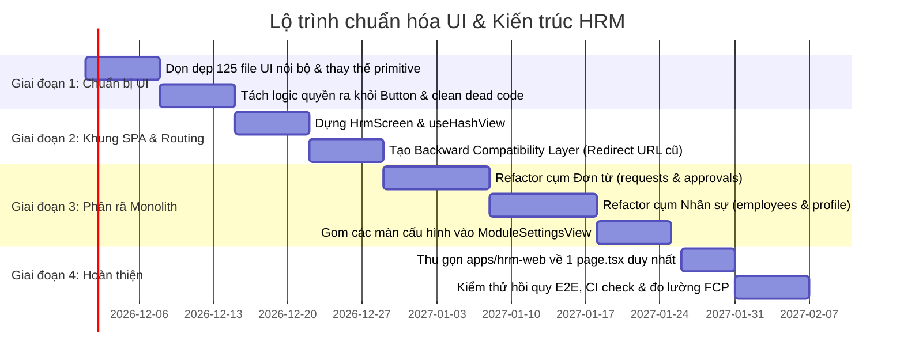

# Tổng Hợp Kế Hoạch Chuẩn Hóa Giao Diện & Kiến Trúc UI Phân Hệ HRM Theo Chuẩn Chung

- **Ngày lập:** 21/11/2026
- **Vị trí tài liệu:** `docs/test/TONG_HOP_KE_HOACH_CHUAN_HOA_UI_HRM_THEO_CHUAN_CHUNG.md`
- **Phạm vi tác động:** 
  - Giao diện HRM: `apps/hrm-web`, `packages/features/hrm`
  - Tham chiếu chuẩn: `packages/features/inventory`, `packages/features/maintenance`, `packages/features/correspondence`
  - Nền tảng dùng chung: `packages/features/module-shell`, `packages/shared/ui`

---

## 1. Bối cảnh & Đánh giá Nhận định Thực tế

### 1.1 Kiểm tra tính chính xác của nhận định: *"Trước đây có thảo luận đồng bộ UI chung, nhưng HRM gặp nhiều khó khăn do thiết kế riêng từng trang nhiều"*
Nhận định trên **hoàn toàn chính xác** và phản ánh đúng thực tế mã nguồn:
1. **Định hướng đồng bộ đã có từ trước**: Toàn bộ hệ thống Enterprise Platform đã thống nhất bộ quy chuẩn tại `AGENTS.md` và `.agents/skills/ui-design/SKILL.md`:
   - Khung bao ngoài là `ModuleShell` sáng, dùng hệ token CSS `--ep-*`.
   - Tech stack cốt lõi: `shadcn/ui` + `Tailwind CSS` cho tương tác cơ bản; `Ant Design (antd)` cho dữ liệu phức tạp (Table/DataGrid, Tree); dùng `SearchableSelect` thay thế `<select>` thô; cấm hoàn toàn emoji; tối ưu layout tỷ lệ 16:9 master-detail.
   - Các module sinh sau hoặc tái cấu trúc (như `inventory`, `maintenance`, `correspondence`) đã chuyển dịch thành công theo chuẩn này (tiêu biểu như commit `b727c8fa`: *"chuyển giao diện Kho sang shadcn/ui và Tailwind theo nguyên mẫu HRM"*).
2. **HRM gặp khó khăn lớn nhất do "thiết kế riêng từng trang"**:
   - **Quy mô mã nguồn áp đảo**: `packages/features/hrm` hiện có tới **1.052 files** (gấp đôi CRM: 540 files, gấp 5 lần Inventory: 226 files). Riêng thư mục `packages/features/hrm/src/lib/ui` đã chiếm **125 files** component riêng rẽ.
   - **Các file màn hình dạng Monolithic khổng lồ**: Từng màn hình trong HRM được xây dựng riêng lẻ, nhồi nhét toàn bộ logic nghiệp vụ, form, filter, preview vào một file:
     - `requests-screen.tsx`: **5.477 dòng**
     - `operations-screen.tsx`: **4.100+ dòng**
     - `payroll-screen.tsx`: **4.000+ dòng**
     - `employees-screen.tsx`: **2.638 dòng**
     - `profile-screen.tsx`: **2.513 dòng**
   - **Nợ kỹ thuật phân mảnh**: Từng màn hình tự quản lý state tab nội bộ (F5 là mất vết), tự tạo drawer/dialog riêng, tiêu đề trang chồng chéo (vừa h1 của shell vừa h1 của screen), nhãn ngữ nghĩa Anh-Việt lẫn lộn, cách gọi API không đồng nhất (có chỗ dùng `hrmFetch`, có chỗ dùng `fetch` thô tự đính kèm `csrfToken`).

Do đó, khi đặt bài toán quy tụ về một chuẩn giao diện chung, HRM chính là phân hệ phức tạp và cồng kềnh nhất, đòi hỏi phải có lộ trình chuyển đổi cẩn trọng.

---

## 2. Cách Triển Khai UI ở các Module Chuẩn Mẫu (`inventory`, `maintenance`, `correspondence`)

Khác với HRM, các phân hệ Kho, Bảo trì và Văn thư áp dụng một kiến trúc tinh gọn và thống nhất:

```
┌────────────────────────────────────────────────────────┐
│ apps/<module>-web/src/app/page.tsx                     │
│ └── Render duy nhất <ModuleScreen />                   │
└──────────────────────────┬─────────────────────────────┘
                           ▼
┌────────────────────────────────────────────────────────┐
│ packages/features/<module>/src/lib/<module>-screen.tsx │
│ ├── Quản lý điều hướng qua useHashView (SPA 0ms)       │
│ ├── ModuleShell (Navigation Rail, Header, Chat, AI)    │
│ ├── Tải dữ liệu chung 1 lần duy nhất                   │
│ └── Switch-case điều phối các Hub chuyên biệt          │
└────────────┬─────────────────────────────┬─────────────┘
             ▼                             ▼
┌─────────────────────────┐   ┌──────────────────────────┐
│ Hubs / Views Chuyên Biệt│   │ Overlays                 │
│ ├── TransactionHub      │   │ ├── Drawer trượt bên phải│
│ ├── StocktakeHub        │   │ └── Dialog Modal nổi     │
│ ├── AssetTree           │   │ (Đóng lại về đúng view)  │
│ └── ModuleSettingsView  │   └──────────────────────────┘
└─────────────────────────┘
```

1. **Kiến trúc Single-Page Module (SPA) & Điều hướng Hash (`useHashView`)**:
   - `apps/<module>-web/src/app` chỉ có đúng **1 route `page.tsx` duy nhất**.
   - Mọi chuyển đổi tính năng đều dùng URL Hash (`#stock`, `#stock/warehouse`, `#assets`, `#letters/<id>`).
   - Không bị reload trang, không chớp nháy (zero flash), thông tin phân quyền và định danh người dùng chỉ nạp 1 lần ban đầu tại Root Screen.
2. **Cấu trúc phân tầng: Root Screen $\rightarrow$ Hubs/Views $\rightarrow$ Drawers/Dialogs**:
   - Màn hình chính đóng vai trò nhạc trưởng điều phối các View con.
   - Xem chi tiết hoặc thêm mới thì mở **Drawer (Sheet)** trượt từ cạnh phải đè lên danh sách hiện tại thay vì chuyển sang một trang mới.
3. **Bộ UI Components tinh gọn & Dùng chung**:
   - Thư mục `ui/` nội bộ chỉ có **10–15 component nguyên thủy** (`button`, `input`, `card`, `dialog`, `badge`, `sheet`...) bọc từ Headless Radix UI / Base UI và Tailwind CSS.
   - Tận dụng triệt để các component khung nền tảng: `ModuleShell`, `ModuleSettingsView` (trang cài đặt dạng khai báo mảng sections), `DashboardCardPicker` (tùy biến thẻ số liệu tổng quan).
4. **Bố cục chuẩn 16:9 Master - Detail**:
   - Cột trái (~40-45%) hiển thị danh sách; Cột phải (~55-60%) hiển thị chi tiết và tác vụ.
   - Viewport khóa chiều cao `calc(100vh - headerHeight)`, thanh cuộn tinh tế tự ẩn khi không tương tác và hiện mờ khi rê chuột.

---

## 3. Đánh Giá: Mô Hình trên Đã Là Chuẩn Mẫu Chưa hay Còn Gì Thêm?

### 3.1 Những điểm ĐÃ LÀ CHUẨN MẪU (Nên nhân rộng sang HRM):
- Kiến trúc Single-Page Module với `useHashView`.
- Mô hình phân rã Screen $\rightarrow$ Hubs $\rightarrow$ Drawers.
- Tận dụng `ModuleShell`, `ModuleSettingsView` và `DashboardCardPicker`.
- Bố cục 16:9 Master-Detail.

### 3.2 Những điểm CÒN THIẾU để đạt mức "1 Khung UI Component Toàn Diện":
1. **Thiếu Design System tập trung cho Primitive Components (Vẫn đang bị Copy-Paste)**:
   - Các component cơ bản (`Button`, `Input`, `Dialog`, `Sheet`...) hiện vẫn đang bị copy-paste trùng lặp giữa `inventory/src/lib/ui`, `maintenance/src/lib/ui` và `hrm/src/lib/ui`.
   - *Giải pháp*: Cần gom toàn bộ primitive components này vào `@enterprise-platform/shared-ui` để các module import dùng chung.
2. **Cần chuẩn hóa lớp bọc phân quyền (Declarative Permission Gate)**:
   - Thay vì cấy logic quyền vào sâu trong từng nút bấm (như HRM) hoặc viết `if/else` rải rác, cần một component wrapper chuẩn:
     ```tsx
     <RequirePermission action="hrm.employee.manage" fallback={<Button disabled />}>
       <Button onClick={handleAdd}>Thêm nhân viên</Button>
     </RequirePermission>
     ```
3. **Cần đóng gói sẵn Wrapper cho Ant Design Table**:
   - Cần một component `<DataTable />` dùng chung trong `shared-ui` đã cấu hình sẵn theme token, font `Be Vietnam Pro`, hover state và phân trang chuẩn, tránh việc mỗi module phải viết override CSS thủ công.
4. **Chuẩn hóa Form Validation**:
   - Thống nhất một giải pháp duy nhất cho form (`react-hook-form` + `zod` schema).

---

## 4. Kế Hoạch Chuyển Đổi Phân Hệ HRM Theo Chuẩn Chung

### 4.1 Kiến trúc đích của HRM (Target Architecture)

Toàn bộ 20+ route rời rạc của HRM sẽ được quy hoạch lại thành **6 Hubs chính** điều hướng bằng hash:

| Hash View | Tên Hub | Chức năng nghiệp vụ & Màn hình gộp | Dạng hiển thị |
|---|---|---|---|
| `#dashboard` | **Tổng quan** | Bàn làm việc HRM, widget chấm công nhanh, số đơn chờ duyệt, thẻ kỳ công/lương. | Grid Cards (`DashboardCardPicker`) |
| `#my-work` | **Cá nhân** | Gộp các màn nhân viên: Chấm công của tôi (`#my-work/attendance`), Đơn từ của tôi (`#my-work/requests`), Hồ sơ của tôi (`#my-work/profile`), Phiếu lương (`#my-work/payslips`). | Tabbed Hub + Drawer chi tiết |
| `#personnel` | **Quản lý Nhân sự** | Danh sách nhân viên, Chức danh, Người phụ thuộc, Quyết định nhân sự. | Master-Detail 16:9 + `EmployeeDetailDrawer` |
| `#timekeeping`| **Chấm công & Phân ca**| Danh mục ca, Phân ca làm việc, Bảng công tổng hợp (ma trận chấm công). | Ant Design Table + Drawer |
| `#approvals` | **Xử lý Đơn từ** | Trung tâm xét duyệt 7 loại đơn tập trung. | Master-Detail 16:9 (Trái: danh sách chờ, Phải: chi tiết đơn & nút duyệt) |
| `#payroll` | **Tiền lương** | Tính lương, phát hành phiếu lương, tạm ứng và giải ngân. | Process Hub + Drawer |
| `#settings` | **Cài đặt hệ thống** | Cấu hình chấm công/thiết bị, Cấu hình lương, Phép năm, Phân quyền. | `ModuleSettingsView` (Sections) |

---

### 4.2 Lộ trình thực hiện 4 giai đoạn (Chiến lược Strangler Fig)



#### Giai đoạn 1: Chuẩn bị & Dọn dẹp kho UI Component (Tuần 1 - 2)
1. Rà soát 125 files trong `packages/features/hrm/src/lib/ui`:
   - Giữ lại các UI nghiệp vụ đặc thù: `MonthlyAttendanceMatrixTable`, `PayrollVersionTimeline`, `TripDayLinesPanel`...
   - Thay thế các primitive component (`button`, `input`, `badge`, `card`, `dialog`, `sheet`) bằng bộ chuẩn đồng bộ với `inventory`.
2. Bóc tách logic `useHrmPermissions` ra khỏi component `Button`, chuyển thành wrapper độc lập `<RequirePermission>`.
3. Xóa bỏ mã chết (dead code) đã được chỉ ra trong audit: `leave-settlement-policy-card.tsx`, `HrmRequestDrafts`, các nút xuất file giả.

#### Giai đoạn 2: Xây dựng `HrmScreen` & Bộ định tuyến Hash tương thích ngược (Tuần 3 - 4)
1. Khởi tạo `HrmScreen.tsx` trong `packages/features/hrm/src/lib/`:
   - Cấu hình `useHashView<HrmView>` với danh mục Hash Views chuẩn.
   - Bọc bằng `ModuleShell` giao diện sáng (`appearance="light"`).
2. Xây dựng **Backward Compatibility Layer (Lớp chuyển tiếp tương thích ngược)**:
   - Trong các file `apps/hrm-web/src/app/**/page.tsx`, thay vì render màn hình cũ, thêm cơ chế tự động chuyển hướng về hash tương ứng:
     ```tsx
     // apps/hrm-web/src/app/approvals/page.tsx
     'use client';
     import { useEffect } from 'react';
     import { useRouter, useSearchParams } from 'next/navigation';

     export default function LegacyApprovalsRedirect() {
       const router = useRouter();
       const searchParams = useSearchParams();
       useEffect(() => {
         const query = searchParams.toString();
         router.replace(`/modules/hrm#approvals${query ? `?${query}` : ''}`);
       }, [router, searchParams]);
       return null;
     }
     ```
   - Đảm bảo 100% deep-link từ chuông thông báo, email hoặc chat (dạng `/modules/hrm/approvals?id=123`) tự động chuyển thành `#approvals/123`.

#### Giai đoạn 3: Phân rã các màn hình Monolith thành Hubs & Drawers (Tuần 5 - 7)
1. **Cụm Đơn từ (`requests-screen` & `approvals-screen`)**:
   - Tách `requests-screen.tsx` (5.477 dòng) thành:
     - `RequestsHub`: Danh sách và bộ lọc đơn cá nhân.
     - `RequestDetailDrawer`: Ngăn kéo xem tiến độ duyệt và trao đổi thảo luận.
     - `NewRequestDialog`: Hộp thoại tạo đơn (chia theo từng loại đơn).
   - Tái cấu trúc `approvals-screen.tsx` thành `ApprovalsHub` chuẩn 16:9 (cột trái danh sách đơn chờ, cột phải preview và nút duyệt/từ chối).
2. **Cụm Hồ sơ nhân sự (`employees-screen` & `profile-screen`)**:
   - Xây dựng `EmployeesHub`: Bảng danh sách nhân viên tối ưu với Ant Design Table.
   - Xây dựng `EmployeeDetailDrawer`: Drawer trượt hiển thị toàn bộ hồ sơ (lý lịch, hợp đồng, người thân, chức danh, lương).
3. **Cụm Cài đặt (`settings`)**:
   - Chuyển đổi các trang `/policies`, `/leave-settings`, `/payroll/settings`, `/permissions` thành các sections trong `ModuleSettingsView`.

#### Giai đoạn 4: Thu gọn `apps/hrm-web` & Kiểm thử tích hợp (Tuần 8)
1. Chuyển `apps/hrm-web/src/app/page.tsx` thành cổng vào duy nhất render `<HrmScreen />`.
2. Dọn dẹp các thư mục route trung gian trong `apps/hrm-web` khi hệ thống đã ổn định.
3. Chạy toàn bộ kiểm thử xác thực:
   ```bash
   pnpm nx affected -t lint typecheck test --base=origin/dev/release
   node tools/check-ui-rules.mjs
   ```
4. Đánh giá bundle size và thời gian phản hồi điều hướng (First Contentful Paint & Navigation Latency).

---

## 5. Tiêu Chí Nghiệm Thu & Quản Trị Rủi Ro

### 5.1 Quản trị rủi ro
- **Đứt gãy liên kết cũ**: Giữ nguyên cơ chế redirect tạm thời trong ít nhất 2 chu kỳ phát hành; viết kiểm thử tự động cho bảng ánh xạ URL cũ $\rightarrow$ Hash mới.
- **Rò rỉ phân quyền client**: Giữ nguyên nguyên tắc "Luật cứng 2" (AGENTS.md): Mọi API phải được bảo vệ ở server qua `@RequirePermission`. Ở client chỉ ẩn hiện theo vai trò.
- **Vỡ bố cục trên màn hình nhỏ**: Kiểm thử trực tiếp trên các kích thước màn hình phổ biến: 1920x1080 (16:9), 1600x900, và 1366x768.

### 5.2 Tiêu chí hoàn thành (Definition of Done)
- [x] Phân hệ HRM chạy trên 1 Next.js page duy nhất với `useHashView`.
- [x] Không còn file màn hình nào trong HRM vượt quá 1.000 dòng code.
- [x] Không còn component primitive copy-paste dư thừa trong `packages/features/hrm/src/lib/ui`.
- [x] Vượt qua 100% các script kiểm tra (`check-ui-rules.mjs`, `sync-agent-skills.mjs`).
- [x] Toàn bộ test suite của HRM chạy thành công không có lỗi hồi quy.
